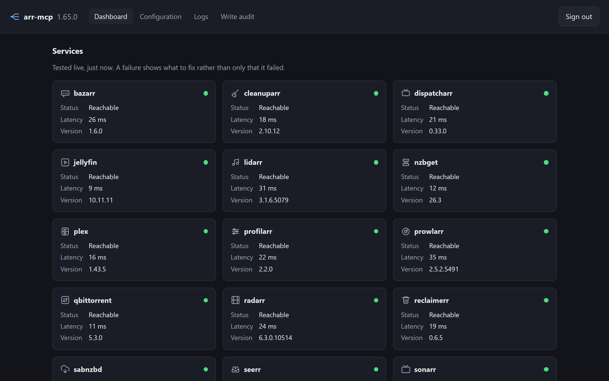
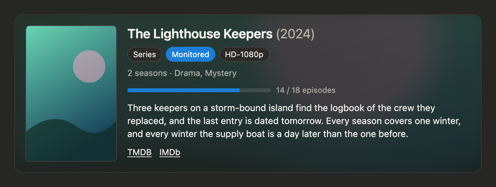
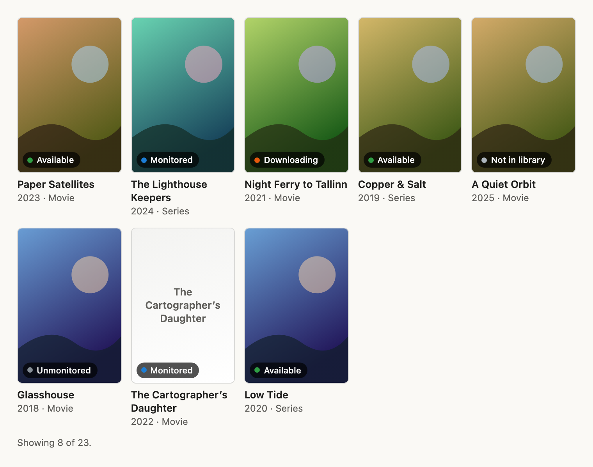

<div align="center">


# arr-mcp

### Talk to your entire media stack. One server, one endpoint, one conversation.

**Radarr · Sonarr · Whisparr · Lidarr · Prowlarr · Bazarr · Jellyfin · Plex · Seerr · SABnzbd · NZBGet · Transmission · qBittorrent · Profilarr · Cleanuparr · Reclaimerr · Dispatcharr · Shelfmark · Grimmory**

[](https://github.com/bardesss/arr-mcp/releases)
[](https://github.com/bardesss/arr-mcp/actions)
[](https://github.com/bardesss/arr-mcp/pkgs/container/arr-mcp)
[](https://github.com/bardesss/arr-mcp/pkgs/container/arr-mcp)
[](LICENSE)



</div>

## Everyone else ships one MCP server per service. This is one for the stack.

That difference is the whole point, because the interesting questions live
*between* services:

> *"Why isn't the film I requested on Tuesday showing up in Jellyfin?"*

No single service can answer that. It spans Seerr, Radarr, Prowlarr, SABnzbd and
Jellyfin. Five APIs, five sets of ids, five half-answers. arr-mcp correlates
them and hands back the causal chain:

```
diagnose_media { query: "Blade" }
```

> No file on disk yet. Trigger a search in Radarr or Sonarr. Nothing is
> downloading and no indexer reported a failure.

One call. One answer. It even answers with a service down, and tells you which
part it could not check rather than guessing across the hole.

## Why people run it

|  | |
| --- | --- |
| 🔍 **`diagnose_media` answers what no single service can** | Walks the whole chain (requested, managed, monitored, downloaded, indexed, imported, scanned) and names the *first* thing that explains the absence. |
| 🗂️ **A record that outlives the title** | Deleting a title deletes its history. Turn on the [library event log](docs/configuration.md#the-library-event-log) and arr-mcp keeps what Radarr and Sonarr report, so `get_history` and `diagnose_media` can still tell you what happened to it. |
| 🧮 **Quality profiles that cannot do what they say** | A minimum score nothing can reach, a language preferred but never required, a format scored where its wider twin sits at zero. Hand-built or synced from TRaSH Guides through Profilarr, the same checks apply. The arithmetic ones are proved rather than guessed, and every fix names a change to make in Profilarr, which owns them. |
| 🛡️ **Indexer text is data, never instruction** | Release names from public indexers are attacker-controllable and flow straight into model context. arr-mcp fences every one of them. |
| ✋ **Writes are opt-in, previewed, recorded** | Off until you turn them on, per service. Every write shows you exactly what it would do and waits for confirmation, and lands in an audit trail either way. |
| 🖥️ **A config page that diagnoses** | Add services from a browser, see what is broken *and what to do about it*, read the logs and the write audit. No YAML required. |
| 📚 **Forty-six tools, one vocabulary** | Every list pages the same way and answers readably whether or not your client reads `structuredContent`, every error names the config key that would fix it, every write takes ids rather than titles. |

## Quick start: about two minutes

Also in the repo as [`docker-compose.example.yml`](docker-compose.example.yml).
**On Unraid**, use [`unraid/arr-mcp.xml`](unraid/arr-mcp.xml) instead: a
Community Applications template with the appdata path and `99:100` ownership
already set. It is not listed in CA yet, so for now drop it into
`/boot/config/plugins/dockerMan/templates-user/` and pick it from the template
list under **Add Container**. Steps 1 to 3 below are the same once it starts.

**On Proxmox VE**, [`proxmox/`](proxmox/) builds an unprivileged Debian LXC
from source instead, no Docker anywhere. Run it on the host, not in a guest:

```bash
bash -c "$(curl -fsSL https://raw.githubusercontent.com/bardesss/arr-mcp/main/proxmox/ct/arr-mcp.sh)"
```

It defaults to 2 cores, 2 GB and 8 GB of disk. The memory is sized for the
optional [IMDb ingest](docs/imdb.md), not for serving. `config.yaml`, the MCP
tokens (hashed) and the databases live in `/config`, which an update does not touch; run
`update` inside the container to rebuild it from the latest release. Re-running
the command above on the host builds a second container instead. If it installs
but never answers, `journalctl -u arr-mcp` is the log.

It follows the Community Scripts conventions but is not in their catalogue. One
tester has reported a clean install so far
([#265](https://github.com/bardesss/arr-mcp/issues/265)), and arm64 has not been
tried, so the script asks rather than assuming. An install that worked is as
useful to hear about as one that did not:
[open an issue](https://github.com/bardesss/arr-mcp/issues/new/choose). Steps 1
to 3 below are the same once it boots.

```yaml
services:
  arr-mcp:
    image: ghcr.io/bardesss/arr-mcp:latest
    container_name: arr-mcp
    ports:
      - 6060:6060
    volumes:
      - ./config:/config
    environment:
      - PUID=1000
      - PGID=1000
      - TZ=Europe/Amsterdam
    restart: unless-stopped
```

**1. Open `http://<host>:6060`**: the bare host, no path. Nothing to read out
of the container log.

**2. Claim it.** The first page is a setup form rather than a sign-in: choose a
username and a password of at least 12 characters.

> [!IMPORTANT]
> Do this **before** exposing the port. Until it is claimed, whoever loads that
> page first owns the instance, and it holds every service's API key.

**3. Add your services**: **Add a service**, paste its URL and API key (for Plex,
its `X-Plex-Token`; for NZBGet, Transmission, qBittorrent and Grimmory, its username and password; a Shelfmark with no authentication needs no key), save. It applies immediately; there is
no restart. Configure only what you run. A config file that will not parse no
longer takes the container down: arr-mcp serves a repair page with the error and
an editor instead.

Your MCP client goes to `http://<host>:6060/mcp` with an MCP token. Create one on
the config page; it is shown once, so copy it into your client straight away.
Each token has its own tier and expiry, see
[MCP tokens](docs/configuration.md#mcp-tokens). A client that can only be given a
URL, not a header, can carry the token as `?token=` instead; see
[`allow_token_in_url`](docs/configuration.md#allow_token_in_url). If you already
run an identity provider, `/mcp` also accepts short-lived OAuth 2.1 access
tokens, so each client gets its own credential and a scope that caps what it may
do: read-only for one, writes for another, never more than `config.yaml`
already permits. See [`auth.oauth`](docs/configuration.md#authoauth). Everything
the UI does is still just `config.yaml`, and editing that by hand remains
supported. Clients that read the
[MCP Registry](https://registry.modelcontextprotocol.io) find it there as
`io.github.bardesss/arr-mcp`. It is also listed on Glama:

[](https://glama.ai/mcp/servers/bardesss/arr-mcp)

A client that launches its servers as child processes can run arr-mcp
[over stdio](docs/configuration.md#over-stdio) instead, with `--stdio`. That
connection is read-only; writes need `/mcp` and a token.

**Works with whatever you point at it.** A client asking for
`Accept: application/json`, or sending no `Accept` at all, gets one JSON object
back with a `Content-Length`, rather than a refusal for not also naming
`text/event-stream`. A client that does accept a stream still gets one. Even a
refusal is JSON. So a plain `curl` works as-is, and so does a full MCP client.

Image tags are `X.Y.Z`, `X.Y`, `X` and `latest`, plus `main` for bleeding edge.
Pin a minor, `:1.51`, if you would rather approve each new tool surface
yourself. Images are published for **amd64 and arm64**, so a Raspberry Pi or an
ARM NAS runs the same build as everything else.

## What you can ask it

Forty-six tools, but you never name them: you ask, and the model picks:

> *"What's downloading right now, and is anything stuck?"*
> *"What aired this week that I haven't watched?"*
> *"Which of my indexers are failing, and what did they say?"*
> *"Find me something highly rated from 1994 I don't already have."*
> *"Go and find Dutch subtitles for the film that just landed."*
> *"Not that release, grab the 1080p remux instead."*
> *"Why does this episode keep failing and never downloading?"*
> *"Pause SABnzbd, I need the bandwidth for an hour."*
> *"What are my seeding rules, and is anything still seeding past them?"*
> *"That download finished days ago and never got imported. Sort it out."*
> *"Put this series on the 4K profile and only monitor future seasons."*
> *"This profile says it wants Dutch but keeps grabbing English, why?"*
> *"Has anything in Radarr drifted from what Profilarr set?"*
> *"Why is the TV guide empty, and is my IPTV subscription about to run out?"*
> *"Which of my shows have metadata that does not match the files?"*
> *"These episode titles are wrong for the files. Fix them."*
> *"Unmonitor season 5 and delete its files."* Previewed first, always.

## Poster cards in Claude

In a client that renders [MCP Apps](https://github.com/modelcontextprotocol/ext-apps)
(Claude Desktop and claude.ai), a film or series comes back as a card rather
than a line of text. `get_media_details` shows one card: poster, blurred
backdrop, synopsis, genres, runtime or seasons, episode progress, a status badge
(available, monitored, downloading, unmonitored, not in library) with the
quality profile, and links to TMDB and IMDb. `search_media` and
`get_library` show a grid of up to twenty posters, each with its status.




**Nothing to configure, and no TMDB key.** The artwork is what Radarr and Sonarr
already hold (`remoteUrl`, from TMDB and TheTVDB) and the poster paths Seerr
returns from TMDB. The card loads those images straight from `image.tmdb.org`
and `artworks.thetvdb.com`, the only hosts its CSP allows; your services' own
addresses and API keys never reach it. A title with no artwork, or whose image
will not load, gets a plain tile with its name.

**Nothing changes for any other client.** The text answer and
`structuredContent` are identical. The cards ride in the result's `_meta`, which
is not model context, and are only built for a client that says it renders MCP
Apps, or one that says nothing (stateless HTTP). `tools.media_cards: false` turns
them off. The cards are read-only for now.

## Documentation

| | |
| --- | --- |
| **[Tools](docs/tools.md)** | All forty-six (`stack_health` and `diagnose` stay as aliases for one more minor), what each answers, and the fields whose meaning is not obvious |
| **[Writes](docs/writes.md)** | Turning them on, the two tiers, and the preview-and-confirm handshake |
| **[Configuration](docs/configuration.md)** | `config.yaml`, the nine services that take a list, Jellyfin's `default_user`, running Plex and Jellyfin side by side |
| **[Config UI](docs/config-ui.md)** | The four pages, and what each does that is not obvious |
| **[Management API](docs/api.md)** | JSON API for companion apps to see and manage services, settings and tokens, with named read or admin keys you create on the config page |
| **[IMDb ratings](docs/imdb.md)** | The only way to get an IMDb score for a series, and what it costs |
| **[Security](docs/security.md)** | The threat model, walked against the OWASP MCP Top 10, including what it does not solve |
| **[Contributing](CONTRIBUTING.md)** | [Which services qualify](CONTRIBUTING.md#which-services-qualify), how to add an adapter, and the rules an AI agent tends to break |

## Requirements

- At least one supported service, LAN-reachable: Radarr 4.0+, Sonarr 4.0+,
  Whisparr 2.x (V2 only, not Eros), Prowlarr 1.0+, Bazarr 1.4+, Jellyfin 10.9+, Plex Media Server (no minimum enforced; verified on 1.43),
  Seerr 1.0+, SABnzbd 3.0+, NZBGet 21.0+, Transmission 3.0+, qBittorrent 4.1+, Profilarr 2.2.0+, Cleanuparr 2.10.0+, Reclaimerr 0.6.0+, Dispatcharr 0.33.0+, Shelfmark 1.5.0+, Grimmory 3.5.0+
- Lidarr 2.1.3+ for reading, monitoring, adding, changing and deleting artists, its queue, its wanted list and calendar, release search, `diagnose_media`, `trigger_scan` and `get_stack_health`:
  `get_library` lists its artists with their album count, monitoring and file
  state, `get_media_details` lists an artist's albums, and `set_monitoring`
  writes one album's flag or an artist's policy. `search_media` with `source: "discover"` finds artists to
  add, `add_media` adds one by its MusicBrainz id, `update_media` changes its
  profiles, root folder, monitoring and tags, and `delete_media` deletes it.
  Artists join to Jellyfin and Plex on the MusicBrainz artist id. `get_queue`,
  `get_history` and `get_blocklist` include Lidarr, `remove_queue_item` takes a
  Lidarr download (`orphaned: true` clears its orphaned ones), and `trigger_scan` rescans and renames,
  and `import_download` imports for it. `get_stack_health` reports its disks, failing health checks,
  last library scan and, at `detail: "full"`, its recent warnings and errors.
  `get_wanted` and `get_calendar` list its albums.
  `trigger_search`, `get_releases` and `grab_release` search its indexers for an
  artist or its albums, and `fix_metadata` rewrites an artist's file tags from
  Lidarr's metadata.
- Docker, or Node 24+ to run from source
- An MCP client. Protocol revision `2026-07-28` is the native one; clients on a
  2025-era revision are still served

Since 1.0 the tool surface is the public API: renaming or removing a tool, a
parameter or a response field is a **major**, because that break is silent: a
model stops finding a renamed tool rather than raising an error.

## Contributing

**Contributions are welcome, and new service adapters most of all**: Emby and
Deluge would both be accepted today, and
[the list says so in advance](CONTRIBUTING.md#what-would-be-accepted-today),
along with the ones that would not be. An adapter is deliberately the most
self-contained thing in the codebase. Not every service qualifies, and the bar is written down rather than decided per
pull request: [which services qualify](CONTRIBUTING.md#which-services-qualify).
**I cannot test a service I do not run**, so the second bar is that you tested
it against your own live instance and the PR says what you tested and against
which version.

**One adapter remains unverified: qBittorrent.** The maintainer runs neither
Plex nor qBittorrent. Testing means running a build against your own server
and reporting what worked. [Plex](../../issues/180) has since been verified
against two live Plex Media Servers by two volunteer testers, its first write
included, and its metadata repair has since repaired both films and series on a
live server ([#312](../../issues/312)); Lidarr's media-server music reads were
captured by a volunteer against Jellyfin 12.4.0 and Plex Media Server 1.43.5;
[qBittorrent](../../issues/147) has shipped but still waits on the same kind of
report. The maintainer does not run NZBGet either: its adapter was tested by its
contributor against live NZBGet 21.0 and 26.3 ([#391](../../pull/391)). [The
design behind Plex, and what else is on the
list](CONTRIBUTING.md#what-would-be-accepted-today).

**AI-assisted contributions are welcome**, held to the same bar and no other;
arr-mcp is itself built with a coding agent. Point yours at
[CONTRIBUTING.md](CONTRIBUTING.md#if-you-are-working-with-a-coding-agent).

**Missing a tool?** [Open an issue](../../issues/new/choose) describing the
question you could not get answered rather than the tool you think should
exist. Often the answer is a new parameter on one that already exists, and
when it needs a new tool, the unanswered question is the case for it.

## Security

arr-mcp is **not designed to be exposed to the internet.** The `/mcp` endpoint
requires a bearer token because "LAN-only" is a network assumption rather than a
security control. It fronts every service credential you configure and, once enabled, file
deletion, and a home network contains guest phones and IoT devices. Put it
behind a reverse proxy with TLS if it needs to leave the LAN, and pin
`allowed_hosts` if you do.

Beyond the network: writes are off until you enable them, every write is
previewed and confirmed before it acts, and everything a service returns is
fenced as data rather than instruction. [Security](docs/security.md) walks all
of it against the OWASP MCP Top 10, and is equally explicit about what it does
not solve. Found something? [SECURITY.md](SECURITY.md).

## Contributors

Everyone who has had a pull request merged into arr-mcp. The grid updates on its
own as new contributors land.

[](https://github.com/Bardesss/arr-mcp/graphs/contributors)

Testing counts as much as code here, because I cannot test a service I do not
run. Plex is verified because of [@Svnow132](https://github.com/Svnow132)
([#180](../../issues/180)) and [@davidgibbons](https://github.com/davidgibbons)
([#312](../../issues/312)).

## Thanks

arr-mcp is glue; the hard parts belong to other people. Nearly every service it
speaks to is free software maintained largely by volunteers: [Radarr](https://radarr.video),
[Sonarr](https://sonarr.tv), [Whisparr](https://github.com/Whisparr/Whisparr), [Lidarr](https://lidarr.audio),
[Prowlarr](https://prowlarr.com),
[Bazarr](https://www.bazarr.media), [Jellyfin](https://jellyfin.org),
[Seerr](https://github.com/seerr-team/seerr), [SABnzbd](https://sabnzbd.org),
[NZBGet](https://nzbget.com), [Transmission](https://transmissionbt.com), [qBittorrent](https://www.qbittorrent.org),
[Profilarr](https://github.com/Dictionarry-Hub/profilarr), [Cleanuparr](https://github.com/Cleanuparr/Cleanuparr), [Reclaimerr](https://github.com/jessielw/Reclaimerr), [Dispatcharr](https://github.com/Dispatcharr/Dispatcharr), [Shelfmark](https://github.com/calibrain/shelfmark), [Grimmory](https://github.com/grimmory-tools/grimmory), as are the libraries it is built
on: [MCP TypeScript SDK](https://github.com/modelcontextprotocol/typescript-sdk),
[Hono](https://hono.dev), [Zod](https://zod.dev), [Pino](https://getpino.io),
[Vitest](https://vitest.dev), [yaml](https://eemeli.org/yaml/) and
[TypeScript](https://www.typescriptlang.org). If you find arr-mcp useful,
consider supporting them first. [Plex](https://www.plex.tv) is the exception: a
commercial product, but its API carries as much of the work as the rest.

When you enable the [IMDb dataset](docs/imdb.md): information courtesy of
[IMDb](https://www.imdb.com), used with permission, for personal and
non-commercial use.

## Licence

[MIT](LICENSE)
