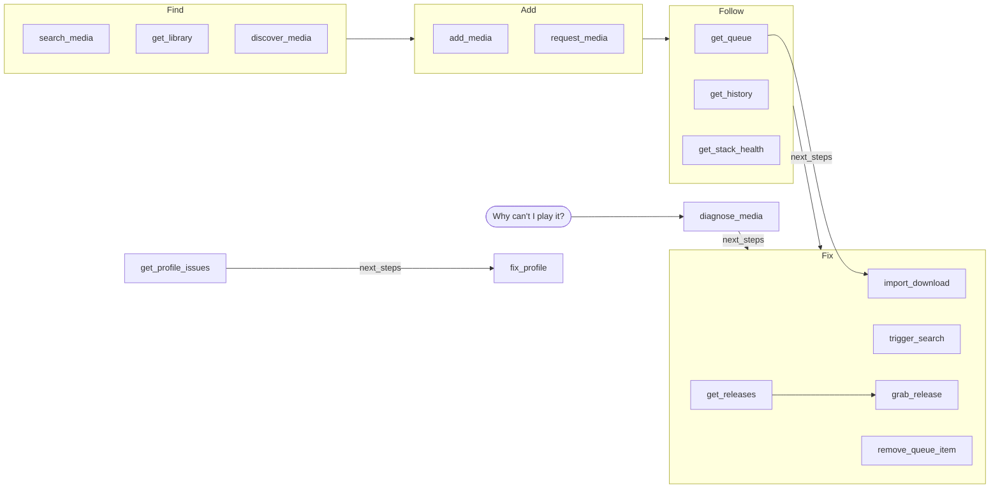

# Tools

Forty-four of them. The first nineteen read; the last twenty-five write, and are
off until you turn them on; see [writes](writes.md).

| Tool | Answers |
| --- | --- |
| `diagnose_media` | Why is this not playable? |
| `get_stack_health` | Is anything broken, out of disk, or not scanning? |
| `get_instance_options` | Which quality profiles, root folders and tags can I pick for Radarr, Sonarr, Whisparr and Lidarr? |
| `search_media` | What do I have, what exists, what can I get? `source: "discover"` tells me about a title without adding it; artists too, with Lidarr, and books, with Shelfmark. Books in Grimmory too, from the library |
| `get_media_details` | Everything about one item; on Lidarr, one artist and the albums under it; on Grimmory, one book and its files |
| `get_metadata_issues` | Which films and series have metadata that does not describe their files; which Grimmory books have a low match score or no identifier |
| `get_library` | What's in my library: joined across Radarr, Sonarr, Lidarr and your media server, and where they disagree; Lidarr artists are their own kind, joined by MusicBrainz id; Grimmory books are their own kind too |
| `get_profile_issues` | Which quality profiles and custom formats are misconfigured, and where Profilarr has drifted from Radarr/Sonarr |
| `get_queue` | What is downloading, across the *arr queues and every download client, and what waits in Grimmory's Bookdrop |
| `get_history` | Why did last night's download fail: grabbed, imported, failed, deleted, and what SABnzbd, NZBGet, Bazarr, Cleanuparr, Reclaimerr and Shelfmark did; on Grimmory, deleted books, metadata changes and scans |
| `get_wanted` | Which episodes of a show are missing, and what has a file below cutoff |
| `get_releases` | What an interactive search actually found, rejects included; on Shelfmark, the files on offer for a book |
| `get_blocklist` | Why does it keep finding the same release and never downloading it |
| `get_calendar` | What is due, and what just aired |
| `get_subtitles` | What is missing subtitles, and which providers are throttled |
| `get_playback` | What am I watching, and what can I continue |
| `get_indexers` | Which indexers are healthy, and what they recently rejected |
| `get_requests` | What has been requested, and what is still pending |
| `discover_media` | What exists in this genre, year, or rating band |
| `trigger_search` | Go look for this again: the whole thing, one season, or specific episodes; on Lidarr, an artist or some of its albums |
| `trigger_scan` | Refresh and rescan a library or one item, rename one item, or rescan a Grimmory library or its Bookdrop |
| `import_download` | Import a download the *arr never took, put a mislabeled Sonarr file on the right episode, rerun NZBGet's post-processing, or approve a Grimmory Bookdrop file |
| `trigger_subtitle_search` | Go and find the subtitles this is missing, now |
| `grab_release` | Not that one: grab this release from `get_releases` instead; on Shelfmark, the most-downloaded file unless you name one |
| `set_monitoring` | Turn monitoring on or off: a whole series (by id or title), one season, specific episodes; on Lidarr, `level: "album"` for one album |
| `retry_download` | Try this failed usenet download again, with its password if it needs one, or a failed or cancelled Shelfmark book |
| `pause_downloads` | Pause, resume or throttle a download client, or one item in its queue |
| `remove_queue_item` | Get rid of this stuck or wrong download, or with `orphaned: true` list the import-blocked downloads the *arr matched to nothing in its library; on Grimmory, discard a file waiting in the Bookdrop |
| `remove_blocklist_item` | Let this blocklisted release be grabbed again |
| `delete_media` | Remove this film, series or artist, optionally from disk; on Grimmory, delete a book and its files |
| `delete_episode_files` | Free disk from one season or a handful of episodes, without touching the series |
| `respond_to_request` | Approve or decline what someone asked for, or retry a failed request |
| `delete_request` | Drop a request record entirely |
| `blocklist_media` | Stop anyone requesting this through Seerr, or an *arr's import lists adding it again; or lift either |
| `request_media` | Ask Seerr for this, through its approval queue and quotas |
| `add_media` | Add this film or series and start looking for it; on Lidarr, an artist; on Shelfmark, a book |
| `update_media` | Change the profile, folder, monitoring or tags of something already there, and a Lidarr artist's metadata profile |
| `update_book` | Edit a Grimmory book's title, authors, series, categories and field locks |
| `fix_metadata` | Repair one item whose metadata does not describe its files; on Grimmory, a book, from its metadata providers; on Lidarr, an artist's file tags |
| `fix_profile` | Apply the fix for a quality profile whose minimum custom format score nothing can reach, or that sits exactly on the edge |
| `set_watched` | Mark this watched or unwatched in Jellyfin; on Grimmory, mark a book read or unread |
| `sync_database` | Have Profilarr pull its database from git again |
| `manage_indexer` | Add a public indexer, change its priority, profile, tags or seeding, or stop grabbing from it |
| `delete_indexer` | Delete a Prowlarr indexer, and its copy in each app |

## Which services each tool needs

<!-- tool-map:start -->
A write is listed only when one of these is configured, and a read too with `tools.hide_unusable`; with nothing configured, everything is. ✎ marks a write.

| Tool | Needs one of |
| --- | --- |
| `diagnose_media` | any stack |
| `get_stack_health` | any stack |
| `get_instance_options` | Radarr, Sonarr, Whisparr, Lidarr |
| `get_indexers` | Prowlarr |
| `get_subtitles` | Bazarr |
| `get_queue` | any stack |
| `get_history` | any stack |
| `get_wanted` | Radarr, Sonarr, Lidarr |
| `get_releases` | Radarr, Sonarr, Whisparr, Lidarr, Shelfmark |
| `get_blocklist` | Radarr, Sonarr, Whisparr, Lidarr |
| `get_calendar` | Radarr, Sonarr, Whisparr, Lidarr |
| `get_playback` | Jellyfin, Plex |
| `get_requests` | Seerr |
| `get_media_details` | any stack |
| `get_metadata_issues` | Jellyfin, Plex, Grimmory |
| `get_library` | any stack |
| `get_profile_issues` | Radarr, Sonarr, Whisparr |
| `search_media` | any stack |
| `discover_media` | any stack |
| `trigger_search` ✎ | Radarr, Sonarr, Whisparr, Lidarr |
| `trigger_scan` ✎ | Radarr, Sonarr, Whisparr, Lidarr, Jellyfin, Plex, Grimmory, Prowlarr |
| `trigger_subtitle_search` ✎ | Bazarr |
| `remove_queue_item` ✎ | Radarr, Sonarr, Whisparr, Lidarr, SABnzbd, NZBGet, Transmission, qBittorrent, Shelfmark, Grimmory |
| `delete_media` ✎ | Radarr, Sonarr, Whisparr, Lidarr, Grimmory |
| `delete_episode_files` ✎ | Sonarr, Whisparr |
| `set_monitoring` ✎ | Sonarr, Whisparr, Lidarr |
| `respond_to_request` ✎ | Seerr |
| `delete_request` ✎ | Seerr |
| `add_media` ✎ | Radarr, Sonarr, Whisparr, Lidarr, Shelfmark |
| `update_media` ✎ | Radarr, Sonarr, Lidarr |
| `grab_release` ✎ | Radarr, Sonarr, Whisparr, Lidarr, Transmission, qBittorrent, Shelfmark |
| `request_media` ✎ | Seerr |
| `pause_downloads` ✎ | SABnzbd, NZBGet, Transmission, qBittorrent |
| `retry_download` ✎ | SABnzbd, NZBGet, Shelfmark |
| `sync_database` ✎ | Profilarr |
| `set_watched` ✎ | Jellyfin, Grimmory |
| `fix_metadata` ✎ | Lidarr, Jellyfin, Plex, Grimmory |
| `remove_blocklist_item` ✎ | Radarr, Sonarr, Whisparr, Lidarr |
| `manage_indexer` ✎ | Prowlarr |
| `update_book` ✎ | Grimmory |
| `import_download` ✎ | Radarr, Sonarr, Lidarr, NZBGet, Grimmory |
| `delete_indexer` ✎ | Prowlarr |
| `blocklist_media` ✎ | Radarr, Sonarr, Lidarr, Seerr |
| `fix_profile` ✎ | Radarr, Sonarr, Whisparr |

What `kind` means, and which services hold it. A `kind` field offers only the kinds a configured service holds.

| Kind | Held by |
| --- | --- |
| `movie` | Radarr |
| `series` | Sonarr, Whisparr |
| `artist` | Lidarr |
| `book` | Shelfmark, Grimmory |
<!-- tool-map:end -->

## Common routes

Most questions take one of these paths. A write previews first and returns a
`confirm` token; nothing below changes anything until it is called again with
it. A `next_steps` edge is a call a result offers, never one it makes.



**Whisparr** is a Sonarr fork and answers wherever Sonarr does below, with one
difference: a site has no seasons, so **a season is a release year**, `2019`
rather than `1`. A year the site does not have is refused, and the refusal
lists the years it does. It does not answer `get_wanted`, `update_media` or
`fix_metadata`, nor `import_download`'s `import` and `remap` actions. `add_media` works as it does on Sonarr,
by TVDB id (Whisparr reuses that field for its own scene-database id, not
TheTVDB), except `series_type` and `monitor_new_items`, which it does not
take, and `monitor: "pilot"`, which a site has no equivalent of. Only Whisparr V2 is supported;
`get_stack_health` reports a V3 (Eros) instance as an unsupported version.

## Every tool answers the same way

Every read tool but `diagnose_media` takes `detail` (`minimal`/`standard`/`full`) and
`limit`, and reports `{ total, returned, offset, truncated }`: a truncated
answer always says so.

**Paging.** Every list tool also takes `offset`: page two of fifty is
`offset: 50`. `total` always counts the whole list rather than the window, so
`offset + returned < total` is how you know another page exists. `truncated`
answers a different question, *this is not the whole list*, and so stays
`true` on the last page of a walk, where everything you already read is behind
you. Pair `offset` with `sort` when the order matters: without one the order is
whatever the services returned, and an item can move between pages.

`get_stack_health` is the exception and takes no `offset`. One `limit` budget spans
its two lists, spent on failures before disks. A disk row is one filesystem:
the mounts every service sees it through are folded into its `mounts` and
`services`, named by path only at `detail: "full"`. The
Reclaimerr candidates under `cleanup`, at `detail: "full"`, take their own
`limit` rather than sharing that budget.

Tools spanning several services also report which ones they could not reach
(`degraded`). Most
of them carry `counts` as well, saying how many results each contributed;
`get_indexers` and `get_subtitles` do not, and every row there names its own
service instead.

Two of those tools carry a second kind of gap. `get_indexers` reads rejection
history alongside the indexers themselves, and `get_subtitles` reads provider
state alongside the gaps; either can fail while the main read succeeds. That is
**not** `degraded` (the instance did answer), so it is reported separately as
`rejectionsUnavailable` and `providersUnavailable`, naming the instances whose
half is missing.

`get_indexers` does the same across instances of one service: it merges every
configured Prowlarr, each row naming the instance it came from, and one
unreachable instance degrades by name rather than emptying the answer. At `detail: "full"` it reads the newest 50
rejections across every Prowlarr, whatever `limit` is; `limit` pages the indexers only.

`diagnose_media` takes a title, or an exact `service` plus `id`, and returns a verdict
rather than a list. With several instances of a service configured it also takes
`instance`, worded exactly as the write tools word it.

**Every answer comes twice: a summary and a structure.** The text block is for
a reader; `structuredContent` is the contract, and every tool declares its
shape as an `outputSchema` so a client knows what it will get before it calls.
A write tool declares only the fields every write result carries (`applied`,
`dry_run`, `tool`, `service`, `operation`, `tier`, `target`, `summary`,
`effects`, `noop` and `permission.allowed`);
`confirm_token`, `warnings`, `next_steps` and the other conditional fields
arrive in `structuredContent` all the same.
Read `total` from there rather than parsing it out of "50 of 243 item(s)",
that sentence is prose and may be reworded.

A list tool's text block is the count sentence *and then one line per item*,
naming each item and the id a follow-up call takes:

```
2 of 1885 item(s).
<<untrusted:radarr.title>>Inception<</>> (2010): movie, radarr:412, tmdb:27205
<<untrusted:sonarr.title>>Severance<</>> (2022): series, sonarr:31, tvdb:371980
```

This matters on clients that do not forward `structuredContent`. The lines are
bounded by `limit`, exactly as the structured half is, and titles keep their
untrusted-data fence.

**The tool list is cacheable for an hour.** On the 2026-07-28 protocol
revision every list result carries a `ttlMs`, and `tools/list`,
`prompts/list` and `resources/list` say an hour, since every tool, prompt and
resource is registered whatever the configuration. Each of the four resources
carries its own hint, and `arr://health`'s is zero. Clients on the 2025
protocol see none of this.

**A client can tell the reads from the writes without reading prose.** Every
tool carries a title and an annotation: `readOnlyHint` on the nineteen that only
read, and on the twenty-five writes `destructiveHint`, taken from the same
permission tier the write gate itself runs on. `idempotentHint` is absent: the
confirmation token is single-use, so repeating a write does not repeat it.

**The server's `instructions`, returned at `initialize`, carry the rules that
hold between tools rather than inside one**, such as what `total` counts and
that a write takes two calls. It is the only documentation every client sees.

**An argument a tool does not have is refused, and the refusal lists the ones it
does have**, so an answer is never mistaken for one where it had been honoured.

## Filtering the queue

`get_queue` takes filters, combined with AND, so a question about a few
torrents does not need the whole queue back: `category` (any of the client
categories given), `status` (a prefix, so `seeding` also matches `seeding (no
peers)`), and four that read Cleanuparr: `over_limit`, `struck`,
`due_within_days` and `unmatched`. Those four read Cleanuparr at any `detail`,
and each takes `false` for the opposite set. `total` counts the matching rows
and `counts` splits them by service; `cleanuparrDue` still describes the whole
queue. A download that has
not finished carries no `seeding`, so no Cleanuparr filter matches it.

### Seed time per tracker

`by_tracker: true` adds `byTracker` to `get_queue`: one entry per tracker
hostname over the matching rows that are seeding now, with `seeding` (how many),
`sizeBytes`, `seedingSeconds` (`total`, `median`, `min`) and `noPeers` when some
seed without peers. Only the hostname is returned, never the announce URL,
which carries the passkey. A torrent with no working tracker counts under
`unknown`. The filters apply first, so `category: ["cross-seed-link"]` with
`by_tracker` shows what cross-seed adds per tracker, and `detail: "minimal"`
with `limit: 1` keeps the rows out of the way.

`min_seed_days` adds `atRisk` per tracker: torrents a Cleanuparr rule stops or
deletes (its `dueAt`) before they have seeded that many days, the hit-and-run
case. arr-mcp cannot know a tracker's minimum, so it is the caller's number.

## Narrowing a read to one kind

`search_media`, `get_queue` and `get_calendar` take an optional
`kind`: `movie` (Radarr), `series` (Sonarr, Whisparr), `artist` (Lidarr) or `book`
(Shelfmark, Grimmory), the same values as `get_library`. Without it they read
every service. With it, a service that holds a different kind is not asked at
all.

- **The search tools** still ask the services that hold more than one kind
  (Seerr, Plex, Jellyfin, Prowlarr), then keep that kind from what they return.
  A hit whose kind the service could not tell, such as an indexer's release or a
  media server's generic item, is kept.
- **`get_queue`** leaves the download clients out. Their rows are the same
  downloads the *arr already lists, and a client cannot say what a download is.
- **`get_calendar`** asks only the *arr holding that kind. `series` covers
  Sonarr and Whisparr, and `artist` gives Lidarr's albums.

**A trailing year is read as a year** in `search_media`:
`Paranormal Activity 2027`, `(2027)` or `[2027]`. The services get the title
alone, and hits from that year rank first among equally good title matches. A
title that ends in its own number still wins over the shorter title, so `Wonder
Woman 1984` comes before `Wonder Woman`. Only years from 1870 to five years ahead
count, which leaves `Blade Runner 2049` whole, and an indexer search keeps the
year, because release names carry it.

## Poster cards

`get_media_details`, `search_media` and `get_library` name the
`ui://arr-mcp/media-cards.html` view in `_meta.ui`, and put its data in the
result's own `_meta`, under `arr-mcp/cards`: `{ view, items, total }`, where
`view` is `detail` for `get_media_details` and `grid` otherwise, `items` holds at
most twenty films and series, and `total` is how many the answer held. Result
`_meta` is not model context, and the text answer and `structuredContent` are
unchanged by it.

A card's `status` (`downloaded`, `monitored`, `downloading`, `unmonitored`,
`absent`) comes from `monitored`, the files on disk and the *arr queue. Text in
it stays fenced, and its image URLs are only ever TMDB's or TheTVDB's.

Cards are built only for a client that declares MCP Apps support
(`io.modelcontextprotocol/ui`), or that declares nothing the server can read,
which is stateless HTTP; `tools.media_cards: false` turns them off entirely
([configuration](configuration.md#poster-cards)).

## `get_history` and the event log

`delete_media` removes a title's history from Radarr, Sonarr or Lidarr along
with the title. With `source: "webhooks"`, `get_history` reads the events those services
reported to arr-mcp instead, so this is the only record that survives a delete.
It needs the [library event log](configuration.md#the-library-event-log) turned
on, and it holds nothing from before that.

`service`, `instance`, `id`, `event_type`, `since` and paging work as they do
for the default `source: "services"`, which never includes stored rows. A service
other than Radarr, Sonarr or Lidarr is refused. `note` says when the log is off or when
nothing has arrived, and an unreadable store is `event-log` in `degraded`.

A stored row differs from a service's own row in a few ways:

- `at` is when arr-mcp received the event, because the payload has no timestamp.
- `id` is arr-mcp's own row number.
- `externalIds` holds TMDB, TVDB and IMDb ids, or a Lidarr artist's MusicBrainz
  id as `mbid`. A re-added title gets a new `mediaId`, and these stay the same.
- A Lidarr row's title is `Artist - Album`. Lidarr's download failure names only
  the release, which is not kept, so that row has no title; its `downloadId`
  links it to the grab. Lidarr 3.1.6 sends an upgrade as a plain import, and
  after an artist delete an album delete per album that says its files were
  kept even when they went, so an album delete only ever says `files deleted`.
- `added` is a new `event`, and events without a captured payload are `unknown`
  with their name in `rawEvent`, at every detail level.
- `reason` is why a file went (`manual`), or for a deleted title whether its files
  went too (`files deleted`, `files kept`).

The Logs page shows the same rows under **Library events**.

## `diagnose_media`

It walks the whole chain (requested, managed, monitored, downloaded, indexed,
imported, scanned) and names the first thing that explains the absence, with
what to do about it.

With two media servers the verdicts are against the primary. The library step
adds "Also in" or "Not in" the other server's library, as extra detail and
never as a blocking stage. A secondary that is down does not lower `certain`.

**It also works with services down.** Any step it could not check sets
`certain: false`, and the summary names what was missed. When the title is found
(in the media server, say) but no *arr claims it, and a Radarr, Sonarr, Whisparr
or Lidarr that holds its kind could not be read, `managed` is `unknown` rather
than "nothing is managing it": the verdict is `managed`, uncertain, and asks you
to check that service and run diagnose_media again, unless a blocked request
comes first. A Jellyfin id gives no kind, nor does a Plex item that is not a
film or a show, so there any *arr that could not be read counts, Lidarr aside
when the item carries a tmdb, tvdb or imdb id, as a film or a show does.

A title the media server shows and nothing manages is `playable`: the summary
says nothing will upgrade or replace it, and there is no step to add it, which
would only download a second copy. Its `managed` step is a `warning` that says
the same. For a film, that copy also outranks a request; for a series, it
outranks a declined request, or one in a state Seerr does not name, which the
summary mentions, while a pending one stays the verdict, since it may ask for
episodes the copy lacks. When a title has several Seerr requests, a pending one speaks for it,
or else the newest. A declined request, or one in a state Seerr does not name,
does not stop a title an *arr monitors: the verdict goes on to the file and the
queue, and the summary mentions the request.

Remedies name the *arr that manages the item. For one nothing manages and the
media server does not show, the `managed` remedy names the *arrs configured here that could manage it (of its
kind, or, when its kind is not known, by the same rule), or says that none is;
for one an *arr has but does not monitor, it names that *arr. The step that
approves a Seerr request names Radarr for a film and Sonarr for a series, the
two that Seerr hands its requests to.

The queue stage words each state for what it is. Three block with a remedy and
the removal step: a `failed` download; one with a warning (the *arrs' `warning`
status, qBittorrent's `stalled`, `error` and `missing files`, or a download
client's row with its own error message, which Transmission sends); and a state
`diagnose_media` does not know. A warning that may be a stall (qBittorrent's
`stalled`, or the *arrs' `warning` when the client's own row is not in the grab
to say otherwise) is told that a stalled torrent often finishes later. On the
*arr's own row, the removal step says to add `blocklist: true` if the release
itself is bad; on a client's row whose grab the *arr's queue lists too, the
remedy says a bad release is blocklisted from there and names the *arr's row and
its instance, since a download client keeps no blocklist and the step removes
the client's row. Where an *arr's row and a client's are in the same state, the
*arr's is the one named and removed. Short of a failure, a finished download is
never offered for removal: a torrent seeding or stopped with nothing left, or a
row with nothing left to download, such as one whose disk filled while
unpacking, may hold the only copy of the files, and its remedy says to fix what
the client reports, after which the *arr imports it (a usenet one's remedy names
the call, below); one whose import is pending on another row of the same grab
gets the import's remedy. A torrent qBittorrent says is missing its files is no
such copy. A download paused or stopped before it finished is read from the
client's own row in the grab. Paused there, it asks you to resume it and offers
`pause_downloads` with its id. The *arrs read every SABnzbd download but a Force
priority one, and every NZBGet download, as paused while that client's whole
queue is. When the paused queue holds the download, the remedy and the step
resume the whole queue, and with the download paused too the remedy names its id
for after. A Force priority download goes on downloading through the pause, so
an NZBGet one is told that nothing there holds it back. SABnzbd's queue also
reads as paused while SABnzbd post-processes, with its "Pause Downloading During
Post-Processing" switch on, and a resume does not end that wait. SABnzbd shows
the wait when no row reads `queued` and one not paused itself, and not at Force
priority, reads `downloading` or `propagating`. A download not paused itself is
then told to wait, and to resume the queue if it stays paused, with no step; one
paused itself is resumed by its id. Without such a row, the queue's remedy adds
that SABnzbd may be waiting so. NZBGet pauses a download's extra repair files on
add, and the *arrs read a download whose paused files are all it has left as
paused, into post-processing, so a row there (`verifying`, `repairing`,
`extracting`, `moving`) is told to wait, unless something holds it. NZBGet's
paused post-processing can hold it, waiting for it, in a par check or repair, or
running a script: then it is told to resume post-processing in NZBGet. A paused
queue can hold repair files a repair asked for: then it is told to resume the
queue, and post-processing in NZBGet as well when that is paused too. Any other
client row gets no resume, since qBittorrent's resume without an `id` restarts
every torrent: one in progress is told that nothing there holds the download
back, and one whose status the adapter could not map only to check the client. A
torrent stopped with nothing left to download has finished: it waits on the
import like a seeding one. A release the *arr holds back and has sent to no
client (`delay`: a delay profile, a usenet minimum age, an indexer disabled
after failures or another release already pending, among others) blocks with no
remedy, like a download in progress, and `downloadClientUnavailable`, a release
the *arr could not send, asks you to check its download clients. A message on an
*arr's row that is not in trouble (NZBGet's PAR status on a finished download,
"qBittorrent is downloading metadata") is not read as a fault; a row still on
its way shows it after "Still downloading".

A finished download waiting on its import is read by the *arr's own import
state (`importState` in get_queue). At `importBlocked` the *arr stopped and does
not try again, so the remedy says to fix what it reports and the step imports
it. At `importPending` with reasons the *arr tried and could not, and tries
again with the same result (a live Sonarr reports a download with no importable
file this way), so the stage says it could not import it and offers the import,
whose preview shows what the *arr finds and why each file is refused, as
get_queue does. While the *arr is importing it, the stage
says so and offers no import, which would only race it, and no remedy unless the
*arr gave reasons.
Without a state, the remedy says to check the *arr's history and the step
imports it, as before. The reasons the *arr gives on its row (`statusMessages`,
such as "Not an upgrade for existing movie file") follow the queue stage's
detail, at most three, with the count of the rest that get_queue lists.
When the row is `orphaned` on Radarr, Sonarr or Lidarr (matched to nothing in
the library), the remedy and the step's `why` both say the import needs a `mapping`
naming what each file is.

A series or an artist reads `playable` once any episode or track is on disk, so
a blocked queue step beside it, even a download in progress or a release held
back, is added to the summary as possibly an episode or album you do not have
yet. A film's file is the whole film, so a grab beside it is only mentioned when
it has a remedy.

An indexer failure that mentions the title is the verdict only when the failing
indexers, with any Prowlarr has disabled for now after failures, are more than
half of those enabled across every Prowlarr, counted by id and only then. Fewer make the `indexers` step a `warning`: a missing file
stays the verdict, with its search step, and the summary names the failures.
When the indexers could not be counted, a failure stays the verdict.

With no row from the client in the grab, only the *arr's row says whether a
torrent has finished, and it cannot tell one missing its files from a finished
one with a problem: the *arrs read both as a warning with nothing left, and only
the message tells them apart, which Radarr and Sonarr word in their UI language.
The removal stays back, since it may be the only copy, and the remedy says to
remove the download if the *arr's message says the files are missing, and
otherwise to fix what it reports. A usenet download with nothing left was filed
in the client's history with a problem, which waiting does not clear, and the
*arr's own download id says which client it was. On SABnzbd (an id that starts
`SABnzbd_nzo_`) the warning is only an unpack that failed for a write error or a
full disk, and the remedy says to retry it with `retry_download` and that id. On
NZBGet (the 32-character `drone` id the *arrs give their grabs there) it is an
unpack out of space, a failed move, a duplicate NZBGet skipped for a copy
already in its history or, on Lidarr, which reads NZBGet's `BAD` delete status
as a warning rather than a failure, a download a script marked bad. Only the
*arr's message tells those apart, so the remedy says to run its post-processing
again with `import_download`'s `postprocess` and that id, or to remove a deleted
one from the *arr's queue, with `blocklist: true` on Lidarr if it was bad.
`retry_download` on NZBGet wants its own history id, which the *arr's row does
not carry. The *arr's id names the client, not the instance, so the remedy says
to make the call on the SABnzbd or NZBGet that holds it, rather than guessing
one where there are two. Any other id is told to fix what the client reports, or
to remove the *arr's queue row if the client deleted the download.
`import_download` says the same when it meets such a download. A state
`diagnose_media` does not know, with nothing left, is only to be checked. Where
these remedies name a removal that no step offers, they name the *arr's queue
row and its instance.

When Cleanuparr removed or stopped the download and nothing is in the queue, the
queue stage says so, with the date, its reason and its strike count, and
`remedy` points at its rules. This only applies while the item has no file; a
file on disk means the removal was since replaced. A dry run is shown as "would
have removed or stopped it" and does not block the verdict. While a download
client cannot be reached, the queue stage is unknown instead, since a new grab
could be on that client. A download still in the queue that Cleanuparr has
struck carries its strike count and kind in the queue stage, as Cleanuparr's own
strike list holds them now, and says when it has reached the strike limit and
goes on Cleanuparr's next run. A torrent still seeding a file that is already in
the library, or stopped after it finished, is `ok`, or `warning` when it has
strikes, including qBittorrent's `seeding (no peers)`; `warning` never blocks
the verdict.

**Unverified live** (Whisparr): the item's history behind the Cleanuparr and Reclaimerr checks; inherited from Sonarr's spec, not captured.

When a query matches nothing in the library, `diagnose_media` searches download
history by release name before answering "Nothing in your stack matches". It
reads Cleanuparr's events (the last 30 days, at most 500) and the history of
SABnzbd and NZBGet; a torrent client keeps nothing once a torrent is removed. A release matches when the query's title words lead
its name, ignoring case, dots, underscores and a leading article. A year or
episode in the query (`Shogun 2024 S01E03`) must not be contradicted by the
release, and a season pack matches any episode of its season. The verdict stays
at `resolve`, and the summary says what happened to up to three matching
releases, for example "Cleanuparr removed … on 2026-10-27: MaxSeedTimeReached,
after 3 strikes." `history` holds the row behind each one. Nothing matching
leaves today's answer, and a history source that could not be read sets
`certain: false`. A query that resolves never triggers this read. A title nothing matches is answered from the library and download history only. A service that has not answered within 10 seconds of the title being found is reported as not checked.

With the [library event log](configuration.md#the-library-event-log) on, that
search covers its last 30 days too, which is how `diagnose_media` can explain a title
deleted from Radarr or Sonarr, since deleting it removes its history from the
service. The summary says, for example, "radarr reported deleting … on
2026-11-05: files deleted." It doesn't say who deleted it, because the payload
doesn't. The store can't be read: `event-log` in `degraded` and `certain: false`.

With Reclaimerr configured, `diagnose_media` looks the title up there by its TMDB id.
When the managing *arr has no file and Reclaimerr deleted or moved the whole
title in the last year, the file stage says so, with the date and the rule, and
`remedy` says to protect it in Reclaimerr before searching again, since the same
rule would otherwise delete it again. A removal of one season or episode leaves
the rest on disk, so it is only mentioned in the summary. When a rule has the
title scheduled for deletion, or eligible at the next deletion run, the summary
says so with the date and the rule. Neither blocks a playable verdict, and a
Reclaimerr that cannot be read only adds it to `degraded`.

With Bazarr configured, `diagnose_media` ends with a `subtitles` step for a title that
has a file. It lists the languages Bazarr is missing for it and is `warning`, not
`blocked`: the verdict stays where the other stages put it, a playable title is
still `playable`, and `certain` does not depend on it. The summary of a playable
title carries the sentence. A gap matches by id and by title, because nothing
says which Radarr or Sonarr a Bazarr is paired with, and a series matches by
series id. The step is `unknown` when Bazarr cannot be read, and `skipped` when
there is no file or no Bazarr. Bazarr's wanted list is read whole, and a failed
read adds Bazarr to `degraded`. Only the first Bazarr is read, as with
Cleanuparr. An item with no id to match gaps by is `unknown`, not `ok`.

**Books.** A book never passes through the chain, so `diagnose_media` refuses one,
including `service: "grimmory"`, before reading anything. The refusal points to
`get_media_details` for the book and `get_stack_health` for Grimmory itself. A book
with the same name as a film is skipped when a title is resolved, and a Grimmory
outage does not lower `certain`.

**Lidarr artists.** `diagnose_media` walks an artist as it does a film: by name, or with
`service: "lidarr"` and the artist id. A film or series of the same name wins over
the artist only when it matches the name as well as the artist does: an artist named exactly
as asked beats a film that merely starts with or contains the name. The chain is the same, with these differences:

- `request` is `skipped`, saying Seerr does not handle music, and Seerr is never
  read for an artist. Neither are Bazarr (`subtitles` is `skipped`, since it has
  no music) nor Reclaimerr, so an outage of any of them costs an artist nothing.
  Cleanuparr is still read when the artist has downloads to match, because it
  explains what happened to a download.
- `queue` reads Lidarr's queue and the download clients', and not Radarr's or
  Sonarr's. A film is read the other way round, so a Lidarr that is down leaves a
  film's verdict as certain as before and makes an artist's `queue` `unknown`.
  Rows are tied to the artist by `mediaId` first. A download client's row counts
  only through a Lidarr row sharing its download id, so a film's release that
  merely shares the artist's name is not blamed on the artist; an orphaned Lidarr
  row is still matched by its release name.
- `file` means any track on disk, as `has_file` does for a series. A missing one
  suggests `trigger_search` on the artist. Lidarr grabs only releases of a
  monitored album, so the albums are read first: with none monitored, the step
  is `set_monitoring` on its only album, or `get_media_details` to choose from
  several, and with no albums at all it is `trigger_scan` to refresh the artist.
  A failed album read is `lidarr:albums` under `degraded` and leaves the search
  step in place.
- `library` follows the music read, not the film read. It is `unknown` when that
  read failed. When the read worked and the server lacks the artist (including a
  server with no music library, or an artist with no MusicBrainz id on the
  server) an artist with tracks on disk is `blocked`: the server cannot see it.
- An artist with a track on disk and everything else clear is `playable`, and the
  summary says that only means at least one track is there: `get_media_details`
  lists the albums and which of them have files.

This has been tested against the recorded Lidarr responses and stand-ins, not
against a running Lidarr.

**Next steps.** Beside the prose `remedy`, `verdict.next_steps` holds the tool
call that does it, as `{ tool, arguments, why }`, and the text block ends with
the same call as a `Next:` line. The server never runs it: a client offers it to
the person, and a write still previews and asks for confirmation. A step names
an instance as `service` plus `instance` (`radarr/hd` is `service: "radarr"`,
`instance: "hd"`). The text a step carries is never a service's: `arguments`
hold ids, `download_id`, and, for a lookup, the words you gave as `query`.

| Verdict | `next_steps` |
|---|---|
| `file`, no cleanup removal | `trigger_search` with the managing service and id; for an artist with no monitored album, `set_monitoring` on its only album or `get_media_details` to choose one, and with no albums `trigger_scan` with its id |
| `file`, removed by a cleanup rule | none: protect the title in Reclaimerr |
| `managed`, not monitored and removed by a cleanup rule | none: monitoring would search for it again. Protect the title in Reclaimerr first; the summary names the removal |
| `managed`, in Radarr | `update_media` with `monitored: true` (`set_monitoring` refuses Radarr) |
| `managed`, in Sonarr or Whisparr | `set_monitoring` with `monitored: true` |
| `managed`, in Lidarr | `update_media` with the artist `id` and `monitored: true`: the artist flag only, each album keeps its own |
| `managed` or `resolve`, nothing manages it | `search_media` with `source: "discover"` with your `query`, only when you diagnosed by title, and for `managed` not while an *arr of its kind (any *arr, for a media server's id with no kind) could not be read; an artist comes back among Lidarr's hits, each with the MusicBrainz id `add_media` takes as `ids.mbid` |
| `request`, pending or failed | `respond_to_request` with `verdict: "approve"` (pending) or `"retry"` (failed), only if you may act on that request (it is yours, or `allow_other_users` is on) |
| `queue`, import pending, including a torrent stopped after it finished | `import_download` with the `download_id` of the *arr's row, on Radarr, Sonarr or Lidarr, unless the *arr says it is importing it itself (`importPending`, `importing`, `imported`) |
| `queue`, failed, a warning or a state it does not know | `remove_queue_item` with the row's service and id; it deletes partial data and does not blocklist, and for a warning on the *arr's own row its `why` says to add `blocklist: true` if the release itself is bad |
| `queue`, paused or stopped before it finished, with the client's own row in the queue, paused too, and no paused queue holding it but SABnzbd's wait for post-processing | `pause_downloads` with `action: "resume"` and that row's service and id |
| `queue`, paused, with the SABnzbd or NZBGet row in the queue held by that client's paused queue, other than SABnzbd's wait for post-processing, whether the row is paused itself or not | `pause_downloads` with `action: "resume"` and that client's service, no `id` |
| `queue`, failed, a warning or a state it does not know, whose import is pending on another row of the same grab, or, short of a failure, whose download is complete in the client, or has nothing left by the *arr's row when no row from the client is in the grab | the import above when there is one, never the removal |
| `library` | `trigger_scan` with `action: "scan"` on the media server |
| playable, one film or episode missing a subtitle | `trigger_subtitle_search` with the first missing language, only when Bazarr gave it a code |
| `scan`, `indexers`, playable otherwise, still downloading, paused with no client row in the queue or one the client neither pauses nor holds, or in NZBGet's post-processing, paused or not, or SABnzbd's wait for it, or a release the *arr holds back (`downloadClientUnavailable` too) | none |

A step is left out when its tool would refuse it or when it cannot be built:
no id to search for, a Whisparr download (which has no manual import), or an
approval for someone else's request without `allow_other_users`. A step is still
offered when the server's own settings would make the write refuse (`safe_write`
off, or a read-tier token): the write then refuses and says how to fix it. The `remedy`
and verdict still say what is wrong. A search offered while Reclaimerr could not
be read says so in its `why`.

An applied `import_download` with `action: "remap"` returns the same field when a
media server that can scan is configured: a `trigger_scan` of it, in place of
the sentence telling you to rescan by hand. Any write can carry `next_steps`; a
step that fails to build never fails a write that already landed.

An applied `update_media` that switches a Lidarr artist's metadata profile
returns a `trigger_scan` of the artist, unless the same call changes the root
folder with `move_files: false`.

## `get_stack_health`

With more than one instance of a service, each is reported separately. With
Plex and Jellyfin both configured, `primaryMediaServer` names the one the tools
default to.

The `service` of each `services` row is the instance id other tools take as
`instance`.

At `detail: "full"` it also reports `permissions`, what each instance may do,
and `endpoints`: `instance`, `service` and `baseUrl` for every configured
instance, so a script knows where each one lives. Both are static config, the
same on every call, so `minimal` and `standard` leave them out. `endpoints`
never carries a key: **no tool in this server returns an API key**, because
anything a tool returns passes through a model's context. A script that needs
credentials runs beside `config.yaml` and imports `loadConfig`.

### Which services report health checks

`failures` carries what each service says is wrong with itself. Radarr,
Sonarr, Whisparr, Lidarr, Prowlarr and Bazarr report their own health checks,
NZBGet its `systemhealth` alerts (v26 and later), and Cleanuparr, Reclaimerr,
Dispatcharr and Shelfmark their own status (see [Dispatcharr](#dispatcharr) and
[Shelfmark](#shelfmark) below). Grimmory reports unreachable libraries, old
Bookdrop files and a newer release (see [Grimmory](#grimmory) below).

Sonarr adds one of its own: a warning, from one read of its naming config, when
an episode format still ends in ` [arr-mcp-remap]`. That marker is left by a
remap rename that was interrupted, and every episode imported meanwhile is named
with it.

SABnzbd reports the warnings and errors from its log, and only those from the
last 24 hours, since its list keeps every row until a restart or a clear. Rows
from the same source are collapsed into one, with the newest text and a count of
the rest. The text is in SABnzbd's own UI language.

qBittorrent, Transmission, Plex, Jellyfin, Seerr and Profilarr have no health
report this server reads. They appear in `services` with their version and
connection state, and a fault in one of them shows up as a failed connection
in `degraded` rather than in `failures`.

### Profiles, root folders and tags: `get_instance_options`

`get_instance_options` takes optional `service` and `instance` (an id as `get_stack_health`'s `services`
lists it); an `instance` that does not exist is refused with the ones that do.

It lists, per Radarr, Sonarr, Whisparr or Lidarr instance, the
`qualityProfiles`, `rootFolders` and `tags` it actually has. Lidarr's metadata
profiles are not listed here: `add_media` and `update_media` name them when one
must be chosen. These are the values `add_media` and `update_media` refuse to
guess at: with more than one profile they insist you name which. An
instance whose profile list cannot be read is named in `degraded` and left out
of `items`.

Each root folder also carries `unmappedFolders` when the instance reports any:
the folder names under that root it associates with no item. It is the only
trace the API gives of a mapping the service has lost: an item whose files it
no longer knows about is never renamed, upgraded or searched for again. A
folder dropped in by hand and a delete that kept its files look the same from
here. Absent rather than empty when the root is fully mapped.

### Seeding rules, at `detail: "full"`

`seedingRules` answers "what are my seeding rules". `clients` gives each
torrent client's default `ratioLimit` and `seedingLimitSeconds` (absent means
none) and the `action` it takes on reaching one. `indexers` gives each torrent
indexer's `seedRatio` and `seedTimeSeconds` from Radarr, Sonarr, Whisparr, Lidarr
and Prowlarr, `packSeedTimeSeconds` for Sonarr's season packs, Lidarr's
discographies and Prowlarr's packs, plus Prowlarr's `privacy`. An *arr hands its indexer's criteria to the
client with every grab, and they override the client default, so the indexer
row is usually the one that decides.

`notes` names two gaps. One is an app's copy of an indexer that disagrees with
Prowlarr's, matched on the `"<name> (Prowlarr)"` name sync gives it. The copy is
what the app applies. The other is a torrent indexer with no criteria while no
client has a default either, meaning its grabs seed until someone stops them.
When an enforced Cleanuparr rule set limits seeding on one of the clients, those
indexers get one note instead, saying Cleanuparr's rules are the only limit and
that a torrent in a category no rule covers still seeds on. Which torrents are actually past their limit is `get_queue`'s answer, not this
one. Absent when nothing configured seeds.

### Cleanuparr

With Cleanuparr configured, its health findings join the failing checks: an
unhealthy entry, a disconnected *arr or download client, a Queue Cleaner that
is not scheduled, dry run being on, the manual events waiting for a person (one
line: how many, and the newest one; an `error` when any of them is one), and a
Cleanuparr minor newer than 2.11 (flagged as untested). A source it could not
read is a warning of its own, and the rest still report.

At `full`, `seedingRules.cleanuparr` lists the rule sets of each Cleanuparr
download client. A set carries `service` when it maps to an arr-mcp torrent
client, matched on client type and `host:port`. A set that matches none, or that
shares a client with another set, has no `service` and `notes` says why.
`notes` also says when a rule's ratio differs from the client's own, and when
the Download Cleaner is not scheduled, which means none of the rules run.

`seedingRules.coverage` checks the rules against the torrents. For each
torrent client a rule set maps to, it reads the client's torrents (one call,
the same read as `get_queue`) and gives `torrents`, `uncovered` (no rule
matches, so the Download Cleaner never removes them) and `ignored` (on
Cleanuparr's ignore list, so not counted as uncovered). Counts only, never a
torrent list. When some are uncovered, `notes` breaks the count down by why:
no category, a category no rule names (the five biggest, with counts), a
tracker, tag or public/private filter. A torrent the client reports no working
tracker or no private flag for is counted, and the note says a rule may still
cover it. On Transmission the category is the last folder of the download dir,
as Cleanuparr reads it.

`notes` also names:

- rule categories no torrent on the client is in, which is usually a typo or a
  category renamed in the client. Categories come from the torrents, so one the
  client defines but nothing uses counts as absent. The categories Unlinked and
  Dead move torrents into are left out, since those are often empty.
- a Cleanuparr client with no seeding rules, and whether Unlinked, Dead and
  Orphaned are all off too, in which case the Download Cleaner does nothing
  with it.
- a configured torrent client that no enabled Cleanuparr client matches on type
  and `host:port`. Deleting a client in Cleanuparr drops its rules and its
  Unlinked, Dead and Orphaned settings, so this is what that looks like
  afterwards. It also fires when Cleanuparr reaches the client under a different
  host than arr-mcp does.

A client whose torrents could not be read gets no `coverage` row and joins
`degraded`. Which rule covers a particular torrent is `get_queue`'s answer at
`detail: "full"`.

Each set also carries the Download Cleaner's three per-client modules, when
Cleanuparr reports them. A module that is off is just `{ "enabled": false }`.

- `unlinked`: torrents in `categories` whose files have no hardlinks are moved
  to `target`, a category, or a tag when `useTag` is set. `ignoredRootDirs` is
  where hardlinks are not counted.
- `deadTorrents`: torrents in `categories` that report no seeders on
  `maxStrikes` runs in a row are moved to `target`, the same way.
- `orphanedFiles`: each entry directly inside a `scanDirectories` entry that no
  torrent claims, whose name matches no `excludePatterns` glob, and that is older
  than `minFileAgeHours`, is moved into `orphanedDirectory`. That directory is
  emptied of anything older than `purgeAfterHours`. Absent `purgeAfterHours`
  means it is never emptied.

Paths are fenced. Categories and patterns are not, the same as rule categories.

`notes` adds the following for these modules:

- an Unlinked or Dead Torrents `target` category that none of that client's
  seeding rules covers, so whatever is moved there keeps seeding. A module that
  tags instead is left out, because the torrent keeps the category its rule
  already covers.
- an orphaned directory that is never purged. arr-mcp cannot see how big it
  is, only that nothing empties it.
- for a set mapped to an arr-mcp client, that client's save directories, read
  from its torrents, compared with the scan. Cleanuparr looks only one level
  down, and a torrent claims its save directory and its own top-level entry.
  So a save directory that is not a scan directory is never searched. A folder
  between a scan directory and a save directory counts as one unclaimed entry,
  and Cleanuparr would move it whole, torrents included, unless its name is
  excluded. That is why cross-seed link directories are listed one per
  tracker. Paths are compared as Cleanuparr compares them: either slash, no
  trailing slash, ignoring case. arr-mcp cannot read Cleanuparr's own path
  mapping, so when none of the save directories lies inside any scan
  directory, the note says the two cannot be compared and stops there.

The client's torrents are read once and serve both this and the rule coverage above.

#### Why did my download disappear?

Also at `full`, `cleanuparrRemovals` says when the Queue Cleaner and the
Malware Blocker take a download away, and what that does. It is read-only, like
everything else this server asks Cleanuparr.

`queueCleaner` has `enabled`, `scheduled` (from Cleanuparr's job list),
`schedule` (the cron expression) and one `strikes` row per limit that is on:

| `strike` | Counted when | Notes |
| --- | --- | --- |
| `FailedImport` | the *arr reports an import it cannot finish | `patterns` gives the mode and how many patterns there are, not the patterns. `forceImport` means Cleanuparr tries the import first. |
| `DownloadingMetadata` | qBittorrent is still fetching metadata | qBittorrent only. |
| `Errored` | the torrent client reports the download as errored | Cleanuparr asks the client to resume it on every strike. Cleanuparr 2.10.11 and later. |
| `Stalled` | one row per enabled stall rule, `rule` is its name | |
| `Slow` | one row per enabled slow rule, with `minSpeed` and `maxTimeHours` | |

Each row has `maxStrikes`, `atLimit` (`remove` takes it out of the *arr queue,
`change_category` leaves it in the client under another category), `appliesTo`
(`public`, `private` or `both`) and, when private torrents are judged,
`privateTorrents`: `kept_in_client` or `deleted_from_client`. A metadata stall
always deletes from the client, whatever the privacy, because Cleanuparr's
qBittorrent check asks for it. `completion` shows a rule's completion range when
it is narrower than 0 to 100%.

`onRemoval` says what every removal does. The *arr always blocklists the
release, and `searchesAgain` says whether Seeker search is on, which decides if
a new search is queued. Even with search on, Cleanuparr skips the search for a
download the *arr cannot tie to a film or episode, and for one that keeps
coming back after it passed its limit. `ignoredCount` counts the Queue Cleaner's own ignore list, not
the general one.

`malwareBlocker` lists the `blocklists` turned on per *arr: `type` is
`blacklist` or `whitelist`, and `source` is the host of a URL list or `file`
for a local one. The rest of the URL is dropped in case it carries a token.
Blocked files are skipped in the client. `removesWhen` says whether the whole
download goes when `all_files_blocked` or as soon as `any_file_blocked`.
`privateTorrents` is `skipped`, `kept_in_client` or `deleted_from_client`.

`notes` flags a setting that deletes a private torrent and its files from the
client, which ends its seeding. On a private tracker that can count as a
hit-and-run. It also names a cleaner whose settings could not be read; when
neither can, Cleanuparr is named in `degraded` instead.

One thing it cannot see: a per-*arr override of the failed-import strike count
in Cleanuparr (it is served together with the *arr's API key, so it is not read).

### Reclaimerr

With Reclaimerr configured, its health findings join the failing checks: a
status other than `ok`, no main media server (rules based on watch history
cannot match), a candidate whose deletion failed (with the attempt count and
Reclaimerr's error), an API token missing one of the read scopes arr-mcp uses or
carrying a write scope it does not need, and a Reclaimerr minor newer than 0.6
(flagged as untested).

At `full`, `cleanup` says what its rules will do: `candidates`, soonest first
(`eligible` goes at the next run of the deletion task, then `scheduled` by
`eligibleAt`, then `postponed`, `disabled` and `canceled`), each with its
scope, the rules that matched it, `operation` (`delete` or `move`), `blockers`
and any failed deletion. `rules` lists every rule with its outcome
(`candidate`, `protect` or `match`), `protections` counts the active
protections, `totals` gives the reclaimable and reclaimed bytes, and
`autoDelete.enabled` says whether the deletion task runs at all: when it is
off, nothing is deleted on its own whatever the dates say. The candidate list
takes the call's `limit`; `total` is always the full count. `going` counts the
`eligible` and `scheduled` ones over every candidate, not only the ones
returned, with `firstAt` the soonest date; the summary line quotes it. With more
candidates than one read takes (5,000), they are read again filtered to those
two states, since Reclaimerr lists newest-created first and has no sort; if even
that runs past the cap, `going.capped` is set, `count` is a floor, and the
summary says the first goes on or before `firstAt`.

### Dispatcharr

With Dispatcharr configured, its findings cover the live TV that Plex and
Jellyfin play from it:

| Finding | Level |
|---|---|
| An M3U account failed to refresh | error |
| An M3U account is still pending setup | warning |
| An M3U account has not refreshed in three of its refresh intervals, or has no recorded refresh (skipped on a cron schedule, an interval of 0 or an account still pending setup) | warning |
| A provider account's expiry date has passed | error |
| A provider account expires within 14 days | warning |
| An EPG source failed to refresh | error |
| Dispatcharr is newer than 0.33.x, the minor this adapter was written against | warning |

Accounts, profiles and sources switched off in Dispatcharr are ignored, and so
is the locked built-in `custom` account every install has, whose refreshes
always fail.

A failed refresh says why in a fixed set of words, such as "no playlist URL or
file is set", "the provider refused the login (HTTP 884)", "the guide file was
incomplete or malformed" or "the request timed out", and "refresh failed" when
the cause is not one it knows. Dispatcharr's own error text is never quoted:
it carries the provider URL, and with it the subscription's username and
password, along with whatever the provider sent back.

Dispatcharr is read, never written: there is no tool for its channels or
playlists, and its findings appear only here.

### Shelfmark

With Shelfmark configured, its findings cover book downloads:

| Finding | Level |
|---|---|
| The download coordinator is stopped, so nothing downloads | error |
| Downloads failed in the last 7 days, with the count | warning |

`get_queue` lists books waiting, downloading or failed, as `<title> by <author>`,
with Shelfmark's own reason on a failed one. Finished and cancelled books are left
out. A read-only key cannot see the queue, so `get_queue` reports Shelfmark as
degraded with that key rather than claiming the queue is empty. A book search fails
the same way, as degraded, and Shelfmark is asked again after five minutes.

To get a book, `search_media` with `source: "discover"` finds it (`kind: book`) and `grab_release` with
`service: shelfmark` and that id queues the most-downloaded file, with `safe_write`
on. The preview names the file first. `add_media` with `service: shelfmark` and the same
id does the same, and is a no-op when Shelfmark's queue already holds that release;
Grimmory's library is not checked. Its preview says the file lands in Grimmory's
Bookdrop when Shelfmark writes there (named only with Grimmory configured), to be
approved with `import_download`; the *arr options are refused. To choose another,
`get_releases` lists what
is on offer, most-downloaded first, with rows from sources that count nothing last,
and `grab_release` takes a row's `guid` and `indexer_id`. Shelfmark has no indexer
ids, so `indexer_id` is always 0. Listing searches every source
Shelfmark has and is slow, so a listing is reused for five minutes. Ebooks only.

`remove_queue_item` cancels a queued or running book, with `destructive` on. It
refuses a failed one, which has nothing left to cancel, and
`remove_from_client: false`, because Shelfmark has only the one way to cancel.

`get_history` shows finished, failed and cancelled books as `imported`, `failed`
and `stopped`, with Shelfmark's reason on a failure. It reads the latest 200 books
in Shelfmark's activity list and up to 500 dismissed from it. `at` is when a
dismissed book ended; on the others it is when the book was queued, the only time
Shelfmark gives for them, so a `since` filter works from that. `retry_download`
takes the `id` of a failed or cancelled row, with `safe_write` on, and refuses a
row Shelfmark marks as not retryable. Shelfmark's history has no per-book scope, so
`id` is refused on `get_history`.

`diagnose_media` leaves Shelfmark out, because a book is not on the film and series
chain it walks.

### Grimmory

With Grimmory configured, its findings cover the library and the Bookdrop:

| Finding | Level |
|---|---|
| A library whose folder cannot be reached, by name | error |
| Books left in the Bookdrop for more than a day, with the count and the date of the oldest | warning |
| A newer Grimmory release than the one running | notice |
| A read it could not do: libraries, library health, version or Bookdrop | notice |

The notice for a read names which one failed and, for a 403, says "this account
may not read" it, so a user without `canAccessBookdrop` loses the Bookdrop
finding and nothing else.

**Unverified live** (Grimmory): the Bookdrop age warning, tested on a constructed file.

### Did that command finish?

`commands` is every **followable** task a service has queued or running, plus
anything it finished in the last fifteen minutes: `commandId`, `name`, `status`
(`queued`, `started`, `completed`, `failed`), and the times. Use it to follow
the command id `trigger_search` and `trigger_scan` hand back.

Followable means the tasks this server can start: searches, scans, refreshes,
renames, retags, imports, the Prowlarr sync. The service's own per-minute
housekeeping is left out.

A command the service accepts without returning a command id fails rather than
waiting, since there would be nothing to follow.

Radarr, Sonarr, Whisparr, Lidarr and Prowlarr are read.

**Unverified live** (Whisparr): the `commands` list and the `logs`, inherited from Sonarr's spec, not captured.

**A command that is not in the list has finished.** A search you started a
minute ago is still there with its outcome; older than fifteen minutes is
history, which `get_history` answers. Absent at `detail: "minimal"`, and bounded
like `scans` rather than sharing the `limit` budget.

### Why is it failing?

At `detail: "full"`, `logs` lists the recent warnings and errors each Radarr,
Sonarr, Whisparr, Lidarr, Prowlarr, Seerr and Bazarr wrote to its own log,
newest first. A health check says *what* is broken ("download client
unavailable"); the log line says *why* ("Name does not resolve
(qbittorrent:8080)", a path it cannot write).

The last 50 warning-or-worse lines are read per instance, and lines that differ
only in a date-time are folded into one row: `level`, `logger`, `message`,
`exceptionType`, `count`, `firstSeen` and `lastSeen`. `message` is the newest
line as written. Hosts, ports, IP addresses and other numbers stay in the comparison, so
`server1:8080` and `server2:8080` stay apart. `logs` is an envelope with its own
`limit` budget. A log that cannot be read marks the instance `degraded`.

Those lines are not the whole log. `logs.lines` gives each instance's `read` and
`total`; `count` and `firstSeen` stop at what was read, and a retry storm can
push the line that explains it out of the window. There is no time limit either,
so an old line may no longer apply: `lastSeen` says how old it is. An *arr whose
log database is turned off (its `LogDbEnabled` setting) serves no log lines over
its API, though it still writes its log files: its row in `logs.lines` says
`logDbEnabled: false`, with both 0, and it is not `degraded`.

The `logs` budget is shared between the instances that have rows, so a busy
instance cannot take a quieter one's share. Each keeps up to an equal share of
its own newest rows, and what the shares leave (the remainder, or the unused
share of an instance with fewer rows) goes to the newest rows still left out.
With a `limit` below the number of instances that have rows, the rows are the
newest overall. Rows from the same moment are ordered by instance id.
`logs.total` and `logs.truncated` describe the whole list, so a caller can tell
when rows were left out.

The services differ in a few ways. Seerr's `errorMessage` is appended to
`message`, because that is where it says why, and the rest of what a Seerr line
was logged with is dropped. Bazarr has no logger name, so `logger` is `bazarr`;
its times are local, read in Bazarr's own time zone, or as this server's when
that zone is unknown. It answers with its whole current log, so its `total`
counts the warnings and worse in that. A value that looks like an API key, token
or password, an `Authorization` header's value and any credentials inside a URL
are replaced with `(removed)` in every service's lines. SABnzbd's warnings are
in `failures` rather than here. Jellyfin's real log is plain-text files, and
Dispatcharr and Profilarr have no log to read, so none of the three appears
here.

## `get_library`

Each parameter is described in one sentence in the tool list. The detail
(what `has_file`, `min_rating`, `rating_source`, `presence`, `sort` and
`missing_from` exclude or rescale, and how they combine) is in the
`arr://docs/get_library` resource.

### The ids a write needs

Every merged record carries, under `acquisition`:

| Field | What it is |
| --- | --- |
| `id` | The managing service's own id, as an integer string. This is what `delete_media`, `trigger_search`, `set_monitoring`, `get_releases` and `update_media` take as `id`. |
| `status` | The service's own status word: `continuing`, `ended` or `upcoming` from Sonarr; `announced`, `inCinemas` or `released` from Radarr. Passed through, never normalised: the two vocabularies describe different things. |
| `qualityProfileId`, `qualityProfile` | The profile it grabs against, and its name. |
| `path` | Where the service keeps it on disk. |

and, under `playback`, `itemId`: the media server's own id, which is what
`set_watched` takes. With Plex as primary that id is Plex's, so take it from
`media_servers.jellyfin.itemId` instead, as
[below](#which-media-server-has-it).

**An artist's `acquisition.id` is Lidarr's artist id**, which `update_media`
takes as `id` to set its monitoring. An album id is not on a library row at all: take
it from `get_media_details` on the artist, and pass it with `level: "album"`.
`trigger_search`, `get_releases` and `grab_release` take the artist id as `id`,
with album ids in `albums` or `album` to narrow the search, `update_media` takes
it as `id` to change the artist's profiles, folder, monitoring or tags, and
`delete_media` takes it as `id` to delete the artist.

**A present `qualityProfileId` with no `qualityProfile` means the profile list
could not be read**, not that the item has no profile.

### What am I still waiting for

`has_file: false` with `monitored: true`. Media no *arr manages is excluded
from that answer rather than counted as missing.

### Filters that are films only, and why

`quality` is for films and books. A series has no series-level quality. On a
book it is the file format, such as `EPUB`.

Rating filters are mostly films only too, because Sonarr carries one flat TVDB
rating rather than per-source scores. The exception is `imdb`, which the
[IMDb dataset](imdb.md) supplies for series as well, **and only it does**, so
asking for a series' IMDb rating with the dataset off finds nothing.

Asking for a combination that cannot exist returns a refusal explaining why, not
an empty list. Asking for one that needs the dataset says so in
`ratingCoverage.note` rather than reporting a bare zero.

### Music, from Lidarr

Lidarr adds a third `kind`, `artist`, and it joins to a media server on the
MusicBrainz artist id: the one id both Jellyfin and Plex publish for an artist.

| Field | Meaning for an artist |
| --- | --- |
| `title` | The artist name, fenced like every other service string |
| `ids.mbid` | The artist's MusicBrainz id: Lidarr's `foreignArtistId`, Jellyfin's `ProviderIds.MusicBrainzArtist`, Plex's `mbid://` guid. Matched case-insensitively |
| `albumCount` | How many albums Lidarr holds for the artist. The albums themselves are in `get_media_details` |
| `acquisition.id` | Lidarr's artist id, which `update_media` and `delete_media` take as `id` |
| `acquisition.status` | Lidarr's own artist status (`continuing` or `ended`), passed through |
| `acquisition.addedAt` | When Lidarr added the artist, so `sort: "added"` works |
| `acquisition.hasFile` | At least one track of any album is on disk, the same meaning `has_file` has for a series |
| `acquisition.path` | The artist's folder |
| `presence` | `both`, `arr_only`, `jellyfin_only` or `unknown`, read exactly as for a film. A media server whose music read did not run reports `unknown`, never `arr_only` |

An artist carries **no** rating and no item-level quality, so `min_rating`,
`rating_source`, `sort: "rating"` and `quality` are refused when `kind:
"artist"` names the question. Without a kind they drop artists, which is what an
absent field means everywhere else here. `watched` and `watched_by` drop
artists the same way, because no music watch state is read. With `kind:
"artist"` named, they are refused instead. `sort: "added"` works.

The media server's music read runs only when a Lidarr is configured.

**Album ids are one call down.** `get_media_details` on an artist returns its
`albums`, each with the Lidarr album `id` that `set_monitoring` takes with `level:
"album"`. Nothing in `get_library` returns an album id.

`search_media` with `source: "library"` finds an artist by **name**: "do I have
any Daft Punk" is a library question, and the artist row answers it.
`source: "discover"` answers with Lidarr's
artist lookup: artists to add, each with its MusicBrainz id under `ids.mbid`
and, for one not yet in Lidarr, as `id` too. That id is what `add_media` takes
as `external_id` for Lidarr.

### Books, from Grimmory

Grimmory adds a fourth `kind`, `book`. Its rows are their own source: a book has
no external id, so it never merges with another row, and no media server reads
books, so `presence` is always `unknown`.

| Field | Meaning for a book |
| --- | --- |
| `title` | `<title> by <authors>`, fenced like every other service string |
| `acquisition.id` | Grimmory's book id, which `get_media_details` takes with `service: "grimmory"` |
| `acquisition.quality` | The format of the primary file, such as `EPUB` |
| `acquisition.sizeBytes` | The size of the primary file |
| `acquisition.addedAt` | When Grimmory added the book, so `sort: "added"` and `added_since` work |
| `acquisition.hasFile` | Whether the book has a primary file |
| `playback.watched` | Whether the Grimmory account arr-mcp signs in as has marked the book READ. Unread, unset and never opened all read `false` |
| `library` | The name of the Grimmory library the book sits in, fenced |

A book carries no rating or monitoring. `min_rating`, `rating_source`,
`sort: "rating"`, `watched_by`, `presence` and `monitored` are refused when
`kind: "book"` names the question. Without a kind they drop books, as they do
artists.

Three filters are for books:

- `library` names a Grimmory library, matched ignoring case. It is refused with
  any `kind` other than `book`, and without a kind it drops everything that is
  not a book.
- `quality` matches the format of the primary file, such as `EPUB` or `CBZ`.
- `added_since` takes an ISO 8601 date or timestamp and keeps the books added at
  or after it.

`watched` reads a book's status for the one Grimmory account arr-mcp signs in
as. READ is watched, and every other status, or none, is unwatched. `watched_by`
cannot ask about anyone else and is refused for a book. `set_watched` changes the
status, with `item_id: "grimmory:<book id>"`.

Books are read 200 to a page. A library of more than 20,000 books fails with an
error instead of paging on. An unreachable Grimmory lands in `degraded`, and does
not make a film or series answer less certain.

`search_media` with `source: "library"` finds a book by title or author, and
returns up to 20 hits with the book id. `source: "discover"` returns nothing from
Grimmory. `get_media_details` takes `service: "grimmory"` and that id, and answers
with the book's library, authors, series, ISBN and ASIN when it has them, its
metadata match score, when it was added, and each file with its format and size.
Asking by title alone does not reach a book, and the refusal points to the
`service` and `id` form.

### Sorting

Use `sort` for a superlative ("best-rated"): ordering happens before `limit` is
applied, so the answer is not drawn from an arbitrary window.

Items the chosen source has no rating for are excluded rather than ranked as
zero, and `ratingCoverage` says how many were set aside.

### Seasons, at `detail: "full"`

A series carries `seasons`, one entry per season:

| Field | From | Meaning |
| --- | --- | --- |
| `season` | Sonarr | 0 is specials, reported like any other season: filter `season > 0` if you don't want it |
| `watched`, `lastPlayed` | media server | Per-user watch state |
| `onDisk`, `aired`, `total` | Sonarr | `total` is TVDB's episode count by way of Sonarr |
| `complete` | both | `watched` has reached `total` |
| `monitored` | Sonarr | Its own per-season flag |

**`complete` is absent, never `false`,** whenever either half cannot be
compared (a series no *arr manages has no `total`, one the media server has
never seen has no `watched`), and also for a season Sonarr reports with zero total
episodes, so an unannounced or empty season is never reported as finished.

**`monitored` is absent, never `false`,** for a series no Sonarr manages.
It is the field to check before deleting a season's files, since deleting the
files of a monitored season makes Sonarr search for exactly what you removed.

### Where `seasons` appears

`get_library` omits `seasons` below `detail: "full"`.

A series at `detail: "full"` carries `episodes` on **either** form. Asked by
`service` plus `id`, they come from that service's own view; asked by title,
they are fetched from the Sonarr that manages the series, using
`acquisition.id`. A series no Sonarr manages therefore has none. An episode
read that fails leaves the merged record intact and omits them.

`get_media_details` carries `seasons` at every detail level, on both of its
forms, and `monitored` means the same thing on both.

### `lastPlayed`, and what its absence means

A season row carries `lastPlayed` when the media server has a play date for
anything in that season, and **omits it when nothing in the season has been
played**. Absent means never played: it is not an unknown. `watched: 0` with
no `lastPlayed` is the ordinary shape of a season nobody has started.

### When the media server's episode read fails

`degraded` gains `{service}:seasons`: `jellyfin:seasons` on a Jellyfin
stack, `plex:seasons` on a Plex one. Sonarr's half of `seasons` survives intact
(`onDisk`, `aired`, `total` and `monitored`); only the watch half (`watched`,
`lastPlayed`) and `complete`, which needs both halves, go missing. Film watch
state and `presence` are unaffected.

### Which media server has it

With [Plex and Jellyfin both configured](configuration.md#plex-and-jellyfin-together),
`presence`, `playback` and `seasons` still describe the primary alone. Each
record also carries `media_servers`, saying per server whether it has the item:

```json
"media_servers": {
  "jellyfin": { "present": true, "itemId": "9f3c..." },
  "plex":     { "present": false }
}
```

`itemId` is that server's own id for the item, present when `present` is true.
A server arr-mcp did not read is **omitted**, never reported `present: false`:
the key is missing when the server was down, or when it is a Jellyfin secondary
with no `default_user`, or a secondary whose `default_user` matches nobody (the
`note` then names the setting). A Plex secondary with no `default_user` is read
as the token's owner. The secondary is read as
its own `default_user`, not as the `user` you pass, since names rarely match
across servers. A failed read of it lands in `degraded` by name and leaves
`presence` alone.

The secondary is matched to the primary's items on shared tmdb, tvdb or imdb
ids only, so an item it holds without any of them reads `present: false`.

`missing_from` takes a server id and keeps the items that server reported it
does not have. An omitted entry never matches, so a server that could not be
read gives an empty answer rather than a wrong one. It is offered only when two
media servers are configured.

Items only the secondary has do not appear in `get_library`, because the join
runs against the primary. `search_media` finds them.

A single-server stack sees none of this: no `media_servers` key, no
`missing_from`.

### Which audio languages a file carries

Anything with a file carries `audioLanguages`: the track languages the service
read off the file itself, slash-joined the way the *arrs write them (`jpn/eng`).
It sits on each episode row for a series and on the record itself for a film, so
a series needs `detail: "full"` and a film does not.

This is the field that answers "is the English dub here". A `MULTi` or `Dual
Audio` in a `get_history` release name describes how the grab was labelled, not
what landed on disk.

It is **absent, never empty**, when there is no file, and also when there is
one the service holds no media info for, such as an import that predates a
rescan or a file whose probe failed. Absent means "not known", not "no audio".

**One entry per language, not per track.** The *arrs write one entry per audio
stream, so a file with six English tracks reaches them as
`eng/eng/eng/eng/eng/eng`, which reads as six languages. Repeats are collapsed
and first-seen order kept, so the primary track stays first and `ger/eng` still
means what it looks like. It does not give the number of streams.

On Sonarr and Whisparr it needs a second read of episode files; if that read
fails, only this field is lost. Unlike the free text beside it, the value is not
fenced, so it can be matched against.

### What a cleanup service is about to do to it

With Reclaimerr configured, a record carries `cleanup`, on both the title and
the `service` plus `id` forms:

- `candidates`, soonest first: what its rules matched on this title, with the
  scope (the whole title, one movie version, a season or an episode), the rules,
  `operation` (`delete` or `move`), `state` and `eligibleAt`.
- `protections`: the active protections on it, with `permanent` or `expiresAt`.
- `removals`, newest first: what it deleted or moved of this title in the last
  year.

The title is found by its TMDB id, the one id Reclaimerr's candidates,
protections and events all carry. `cleanup` is **absent** when Reclaimerr has
nothing on the title, when the title has no TMDB id, and when Reclaimerr could
not be read.

`diagnose_media` reads the same thing. A removal of the film (or its version, since
Radarr keeps one file per movie) or of the whole series explains a missing file
only when the managing *arr imported nothing after it. A season or episode
removal is mentioned beside the verdict instead, since the rest may still be on
disk, and so is a version removal on a film that still has a file.

### Adopting what nothing manages

`presence: "jellyfin_only"` lists media the media server shows and no *arr
manages. Two kinds of row there need care before anything is added:

- **An empty folder.** A series the media server holds with no episodes
  carries `playback.empty` and reads `empty folder` in the text. Adding it with
  a search would download the whole series. Only `jellyfin_only` rows carry it;
  where an *arr manages the series, `has_file` already says the same.
- **A wrong match.** An old folder with no id in its name can be matched by the
  media server to another title. `add_media` with `path` checks the folder name
  against the lookup (see below).

`add_media` takes `path`, an existing folder directly inside one of the service's root
folders, as the service sees the disk, to adopt the folder as it is (Radarr,
Sonarr and Whisparr; not Lidarr, which has its own Library Import). The root is
the one holding the folder, or the one `root_folder` names, which must hold it;
a folder outside every root, nested deeper, or with a `.` or `..` segment is refused. The service scans the folder on add,
so its files count as on disk. `search_now` defaults to `false` with `path`.
The preview warns when the folder name disagrees with the lookup: a
`tmdb-`/`tvdb-` id in the name that is not the one given, a year in parentheses
that differs, or a name that shares nothing with the title.

## `get_playback`

`scope` picks which of three reads answers the call, and defaults to `active`.

`scope: "active"` (the default): what can be continued, from Jellyfin's
`/UserItems/Resume`. Each entry carries `percentComplete`, `positionSeconds` and
`runtimeSeconds`.

To find films you are partway through: keep only `kind: "resume"`, keep entries
with no `seriesTitle`, `season` or `episode` (those three appear only on an
episode), then compare `percentComplete` yourself: arr-mcp does not filter by
how far in you are.

`scope: "next_up"`: the next unwatched episode of every series a user has in
progress, from `/Shows/NextUp`, one row per series. `kind: "next_up"`; `title` is the episode, and
`seriesTitle`, `season` and `episode` say which show and where.

`scope: "history"`: recently watched movies and episodes, newest first, from
a sort-by-`DatePlayed` read over played items. `kind: "watched"`; `lastPlayed`
carries the timestamp and survives even at `detail: "standard"`.

That read alone misses plays that never set the played flag, such as an offline
client syncing back. So history also reads Jellyfin's activity log
(`VideoPlaybackStopped`, newest 500 for the whole household, narrowed to the
user), keeps the newest stop per item and drops anything already in the played
list. Every Jellyfin history row says where it came from in `source`:
`marked_played` or `activity_log`.

A logged play counts as `kind: "watched"` unless Jellyfin still holds a resume
position for it, which means the viewer stopped partway: that row is
`kind: "partially_watched"` with `percentComplete`. Logged items that are not
movies or episodes (live TV) are dropped. An item deleted since keeps its row,
titled with the log entry's own sentence, which Jellyfin localises, and
`removedFromLibrary: true`.

Two limits. The log reaches back only `ActivityLogRetentionDays` (30 by
default). And a play that left nothing in the log is invisible here. If the
log read fails, history answers from the played list alone and logs a warning.

Truncation is decided by `limit` (default 50) and reported through `truncated`.

Plex answers the same three scopes from `/status/sessions`, `/library/onDeck`
and `/status/sessions/history/all`. With both configured, the call answers from the
primary; pass `service` (`jellyfin` or `plex`) to ask the other. The answers are
never merged. `service` exists only when two media servers are configured, and
`user` is resolved on the server you chose.

Plex's `/library/onDeck` mixes resume and next-up rows with nothing marking
which is which, so `active` and `next_up` split it by `viewOffset`: non-zero
reads as resume, zero or absent as next-up.

**Unverified live** (Plex): that a non-zero `viewOffset` means resume, the basis of the resume and next-up split. The `/library/onDeck` read itself is captured.

**Plex answers for one user only.** A local `X-Plex-Token` is scoped to a
single Plex account, so every Plex row here is that account's; other users would
need plex.tv, which this adapter does not use. `services.plex.allow_other_users:
true` is refused at config load.

**Known limitation:** the Plex user list assumes the token belongs to the
server owner (`/accounts` id `1`). A managed user's token would be mislabelled
as the owner; this has not been tested.

`set_watched`, below, remains Jellyfin-only, whichever server is primary. The
Plex adapter writes with `trigger_scan` and `fix_metadata`, and `fix_metadata`
has its own switch there, see [Repairing on Plex](#repairing-on-plex).

### When no media server is configured

Every scope answers zero and `degraded` stays empty, since an unconfigured
service is not a degraded one. `note` says no media server is configured, and
the summary line shows it instead of the counts.

`get_library` sets the same `note`: with no media server, its `presence` field
reports `unknown` for everything.

## `get_queue`

Each Radarr, Sonarr, Whisparr or Lidarr row carries `downloadId`, the download
client's own id for that grab. On Radarr, Sonarr and Lidarr it is what
`import_download` takes (Whisparr has no manual import). SABnzbd
and NZBGet rows carry the same id, and a torrent row has it as its `id`, so a
client's row and the *arr's row of one grab match (below).

Below `detail: "full"` a grab is listed once: a client row whose grab an *arr
row also lists is left out, and that *arr row names the client in `client`.
`total` counts the rows after that, and `counts` says how many of them each
service lists, so it adds up to `total`. At `full` both rows are listed, since the client row is where the
seed state and the client's own error are. A filter is applied first, so a
client row only it matches (`status: "seeding"`, say) is still returned.

**Unverified live** (qBittorrent): the torrent list, the seed limits and `by_tracker`; only login and health have met a real server.

**Unverified live** (Cleanuparr): the seeding rules of a Transmission client.

**Unverified live** (Grimmory): a file waiting in the Bookdrop, tested on a constructed file.

Radarr, Sonarr and Lidarr rows also carry `mediaId`, the *arr's own id for the
movie, series or artist the grab is for, and an orphaned row has none. `diagnose_media`
matches a row to a title by that id first, and falls back to the release name
only when a row has none or comes from another instance.

Lidarr rows carry `statusMessages` the same way, and `orphaned` when Lidarr
matched the download to no artist: the artist was deleted, or the release was
never matched.

A row stuck at `importBlocked`, or at `importPending` with `statusMessages` (the
*arr retries it every cycle and fails the same way), gets an `import_download`
step in `next_steps`, at most three of them; `next_steps_more` counts the ones
left out.
On Radarr, Sonarr and Lidarr an `orphaned` one does too, since it may be a
release the service never matched: its `why` asks for a `mapping` naming what
each file is.

`errorMessage` is the download's message, from the client or the *arr: why it is
in trouble, or a note on it (NZBGet's PAR status on a finished download,
"qBittorrent is downloading metadata"). A row carries it only at `detail:
"full"`, with `private`, `seeding`, `strikes` and `markedForRemoval`: `standard`
leaves them out, and `minimal` keeps only `service`, `id`, `title` and `status`.

NZBGet's ETA is worked out from the current download rate and everything ahead
in the queue, and a paused item gets none. A grab added to NZBGet by hand has
NZBGet's own `NZBID` as its `downloadId`, which matches no *arr row. A SABnzbd
row's `downloadId` is the job's `nzo_id`.

NZBGet's statuses take the words the other clients use. Its post-processing
stages, a queue script's (`QS_QUEUED`, `QS_EXECUTING`) and the rename after an
unpack included, read `verifying`, `repairing`, `extracting` or `moving`, and
`PP_FINISHED`, a finished download waiting on its import, reads `completed`. A
download it has just paused reads `paused` while its in-flight articles drain,
since every byte it has left is paused already.

A blocked row also carries `statusMessages`, the service's own reasons, one per
line and fenced. A file the service rejected leads with its filename. They
tell a retry apart from a dead end: "Series title mismatch" or an unknown
episode fails the same way every time, so `import_download` will not
help. Past ten lines the rest are counted, not listed.

### Grimmory's Bookdrop

With Grimmory configured, the files waiting in its Bookdrop are queue rows. Each
has `status: "pending review"`, the file name as its title, and `addedAt` when it
arrived. They are not downloads: arr-mcp has no progress or ETA for them, and
they leave the queue when someone finalises them in Grimmory, or when
`import_download` with the row's `id` imports one. Reading the
Bookdrop needs `canAccessBookdrop` on a non-admin account. It is read 100 files
to a page, and a Bookdrop of more than 1,000 files fails with an error instead
of paging on.

`remove_queue_item` with `service: "grimmory"` and the row's `id` discards the
file. Grimmory deletes it from disk and does not import it, so there is no undo,
and `remove_from_client: false` is refused because there is no way to discard
and keep it. The preview names the file and says so. It is `destructive` and
needs `canAccessBookdrop` on a non-admin account. `blocklist` does nothing here,
and the preview says it is ignored.

### Seeding, at `detail: "full"`

Torrent rows carry `private` when the client says, and a finished torrent
carries `seeding`: `ratio`, `seedingSeconds`, the `ratioLimit` and
`seedingLimitSeconds` the client actually applies to it (absent means none),
`ownLimit` when the torrent overrides the client default, and `overLimit` once
it has reached one. The flags only ever appear as `true`. A row that is still
seeding past its limit says so in its line.

The limits are the client's effective ones. qBittorrent resolves torrent,
category and global itself; Transmission's per-torrent mode is resolved against
its session default here. qBittorrent skips share limits for force-started
torrents, so those carry `forced` and the line says why the limit did nothing.
Transmission has no seeding-time limit, only a ratio.

### Cleanuparr rules, at `detail: "full"`

A torrent that a Cleanuparr rule governs carries `seeding.cleanuparr`: `rule`
(its name), `action` (`delete`, `stop` or `unknown`), the limits it sets
(`ratioLimit`, `seedingLimitSeconds`, `minSeedSeconds`), and flags that only
appear as `true` or text when relevant. `dryRun` means Cleanuparr only logs.
`notEnforced` means its Download Cleaner is not scheduled (one that is running
right now counts as scheduled). `uncertain` says why the rule cannot be judged
from here: it filters on seeder count or last activity, or a tracker rule above
it might be Cleanuparr's pick but the client named no working tracker.
qBittorrent names only a tracker that is working right now, while Cleanuparr
reads them all.

Instead of a rule it can carry `{ skipped: reason }`: the torrent is not
seeding, is ignored in Cleanuparr, is still in an *arr queue, is already
stopped, or the rule's action is unknown.

A torrent on a mapped client that no rule covers carries `{ unmatched: reason }`,
the first filter that ruled every rule out, in Cleanuparr's order: `no category`,
`category not in any rule`, `tracker not in any rule` (or `tracker unknown` when
the client named no working tracker), `tags not in any rule`, then
`privacy mismatch`, or `privacy unknown` when the client did not say whether
the torrent is private. Cleanuparr reads such a torrent as public, so a public
rule takes it and only a private one leaves it unmatched. Torrent rows carry their `category` and `tags`, and an
unmatched one its `savePath` too, so the reason can be checked.

A download Cleanuparr has struck, torrent or *arr row, carries `strikes`, one
entry per kind of strike, since Cleanuparr counts and resets each kind on its own
and dry-run strikes apart from real ones. Each has the `count` since that kind's
last reset, the `reason` (`stalled`, `slow speed`, `dead torrent` and so on),
`lastAt`, when the latest one landed, and `dryRun` when Cleanuparr only logged
it. Real strikes come first, then the highest count. They are Cleanuparr's own
strike list (`/api/strikes`), so a strike it has since reset or acted on is gone.
`markedForRemoval: true` means the download reached its strike limit, and
Cleanuparr removes it on its next run.

When the rule applies and is certain, `overLimit` is judged against it, not the
client's limit, and `limitSource: "cleanuparr"` says so. When it is uncertain,
or the rule sets neither a ratio nor a time limit, the client's own verdict
stays. Rules only reach a client whose host, port and
type match one of Cleanuparr's; see
[Cleanuparr](configuration.md#cleanuparr).

#### When a rule falls due

A rule that is certain and scheduled (no `uncertain`, no `notEnforced`) also
carries `dueAt`, to the second, when its `action` falls due (a `stop` rule
stops the torrent and leaves it in the client).

- Past the rule already: the Download Cleaner's next run, read from its job, or
  now when Cleanuparr gave none or that run is already behind.
- A seed-time limit still ahead: now plus the seed time left. If the next run
  comes later than that, it is the next run.
- A ratio already reached, held back only by the minimum seed time: now plus
  the minimum time left.
- A ratio still to climb depends on upload, which no clock projects, so such a
  rule gets no `dueAt` until the torrent is past it.

A limit reached after the next run is acted on at the first run after it, which
only the cron could name, so `dueAt` is then the moment the limit is reached
and Cleanuparr acts at most one interval later. In dry run it is still given,
beside `dryRun`, because it says when Cleanuparr would log the action.

The answer also carries `cleanuparrDue` when anything falls due within 7 days:
`count` and `sizeBytes` per action (`delete`, `stop`), plus `dryRun` when
Cleanuparr only logs. It covers the whole queue, not just the returned page, and
the summary line says it in one sentence, such as "Cleanuparr is due to delete
3 (12.4 GB) and stop 1 (700 MB) in the next 7 days."

Neither client can express a rule like "public trackers stop now, private ones
seed to 1.0". `private` is there so that question can still be asked of the
queue. On qBittorrent `private` needs 5.0 or later.

## `get_history`

`get_queue` only sees what is still in flight. `get_history` merges Radarr's, Sonarr's, Whisparr's and Lidarr's own history logs with SABnzbd's,
NZBGet's, Bazarr's, Cleanuparr's, Reclaimerr's and Shelfmark's, plus Grimmory's
audit log, and is the only tool that can answer "why did last night's download
fail".

Radarr's and Sonarr's events are normalised to one vocabulary: `grabbed`,
`imported`, `failed`, `deleted`, `renamed`, `ignored`.
Upstream's own spelling survives as `rawEvent`, and an event this server does
not yet recognise becomes `unknown` rather than being dropped.

`event_type` filters on one normalised type: any of the above, or the ones
the services below add (`subtitle`, `strike`, `protected` and the rest), and
`since` drops anything older.

**Unverified live** (Whisparr): its history rows, inherited from Sonarr's spec, not captured.

On a Radarr that ignores the `eventType` parameter (Radarr 4), the filter is applied here and `total` is an upper bound once the read stops early.

A failure's `reason` comes straight from the download client, fenced and
untranslated.

**Lidarr** history is merged too, with its own event names mapped onto the
same vocabulary. It has three imports: `artistFolderImported`,
`trackFileImported` and `downloadImported`, and `albumImportIncomplete`
counts as `failed` beside `downloadFailed`: a download that arrived but could
not all be imported. `trackFileRetagged` reads `retagged`, a file whose tags
Lidarr rewrote. An `event_type` filter on `imported` or `failed` sends Lidarr
every code for that type, so one album's `downloadImported` row is not dropped
behind its tracks' `trackFileImported` rows. `id` with `service: "lidarr"` is an
artist id.

### Cleanuparr

Cleanuparr contributes what it did to downloads. Its event types are `strike`
(a download was struck for stalling, being slow or failing to import),
`recovered` (its strikes were reset), `recategorised` (with `oldCategory` and
`newCategory`), `stopped`, `deleted`, `imported` and `unknown`. Its rows carry
`downloadId`, `strikeCount` where it has one, and `dryRun: true` when it only
logged the action. `downloadClient` names the client the event happened on;
`clientRemoved: true` takes its place when that client has since been deleted
from Cleanuparr. A `reason` is fenced like any other upstream text.

`downloadId` is lowercased and links a row to the *arr grab it belongs to.
Radarr, Sonarr and Lidarr rows now carry the same `downloadId`, also lowercased.
`get_queue`'s `downloadId` is as the *arr reports it, so compare the two
case-insensitively. Passing `id` with
`service: cleanuparr` is refused, because Cleanuparr does not keep history per
movie or series.

### Reclaimerr

Reclaimerr contributes its cleanup lifecycle, read from its event feed:
`scheduled` (a rule matched and a deletion date was set), `deleted` (deleted or
moved; `rawEvent` says which), `protected` (a candidate protected, or a
protection created through its API) and `unknown` for a cancel, a postpone or a
timer reset. `reason` carries the rule names and Reclaimerr's own reason,
fenced. Its feed is oldest first, so without `since` arr-mcp reads the last 7
days and widens to 30, 180 and 730 until it holds the rows asked for. A window holding more than 5000 events
would keep its oldest and drop its newest, so arr-mcp halves it towards now
until it fits; what falls before the narrowed start is left out. Passing
`id` with `service: reclaimerr` is refused: its events are per candidate, not
per movie or series, and `get_media_details` shows one title's cleanup state.

### Shelfmark

Shelfmark contributes its book downloads: `imported` for a finished one, `failed`
with its reason, and `stopped` for a cancelled one, with Shelfmark's own word in
`rawEvent`. See [Shelfmark](#shelfmark) under `get_stack_health` for how much it reads
and what `at` means on its rows. Passing `id` with `service: shelfmark` is refused.

**Unverified live** (Shelfmark): the `failed` and `stopped` rows, tested on constructed answers.

### Grimmory

Grimmory contributes four actions from its audit log. Logins, users, settings
and tasks are never read.

**Unverified live** (Grimmory): the `BOOK_UPLOADED` row.

| Audit action | `event` | What a row means |
| --- | --- | --- |
| `BOOK_UPLOADED` | `added` | A book was uploaded to Grimmory. `mediaId` is the book id when Grimmory logs one |
| `BOOK_DELETED` | `deleted` | A book was deleted. The title is the description Grimmory logged, fenced. On 3.5.0 that is a count such as "Deleted 1 book(s)", which names no book. The row has no book id and no `mediaId`, because Grimmory logs none for a delete |
| `METADATA_UPDATED` | `metadata` | A book's metadata was changed. `mediaId` is the book id |
| `LIBRARY_SCANNED` | `scanned` | A library was scanned. The title reads `library <id>` unless Grimmory logged a description |

`rawEvent` holds the audit action. `event_type` can be `added`, `deleted`, `metadata`
or `scanned`. Each action is read on its own, newest first, up to 1,000 rows, so a
busy action does not push out the rows of a quiet one.

The audit log needs a Grimmory admin account. A non-admin account gets an
`AuthFailed` error that says so, and Grimmory lands in `degraded`. No other
permission opens it.

`since` is sent to Grimmory as a UTC time, and a date or a time without an offset
is read as UTC. Grimmory reads that time in its own zone, which a Docker image
keeps at UTC unless `TZ` says otherwise. Audit times that arrive without an
offset are read as UTC too. Rows older than `since` are dropped on arr-mcp's side
as well.

`id` with `service: "grimmory"` is a book id. It keeps the `metadata` rows for
that book and leaves out scans. A `deleted` row never matches, since it names no
id.

### The services below the *arrs

**SABnzbd** contributes its own history: what happened to a download after it
left the queue. `Completed` becomes `imported`, `Failed` becomes `failed`, and
the `fail_message` is the `reason`.

**NZBGet** contributes its history in the same role. Its `Status` is
`<KIND>/<DETAIL>`: `SUCCESS/*` becomes `imported`, `FAILURE/*` becomes
`failed` and `DELETED/*` becomes `deleted`, except that `DELETED/HEALTH` (aborted
because too many articles were missing), `DELETED/BAD` and `DELETED/SCAN` are
`failed`. NZBGet keeps no failure message,
only a status code per post-processing stage, so `reason` is the status plus
the stages that did not succeed, for example
`FAILURE/PAR (ParStatus FAILURE)`. A row also carries `downloadId` (except at
`detail: "minimal"`), the id `import_download`'s `postprocess` takes to run its
post-processing again. It is the `drone` id an *arr stamped on the NZB, or
NZBGet's own id for one added by hand, and is left out when it is not shaped
like an id.

**Bazarr** contributes `subtitle` rows: what it actually downloaded, and from
which provider (in `quality`, as `language · provider`).

All three refuse a `service` + `id` scope rather than answering an empty list,
since none of them knows a Radarr movie id or a Sonarr series id. A Bazarr row
whose timestamp cannot be read is dropped rather than dated.

Pass `service` and `id` together to scope to one movie or series. `id` without
`service` is refused, since Radarr's movie ids and Sonarr's series ids are
different namespaces.

`mediaId` is the movie, series or artist id; hand it straight to
`get_media_details` or `trigger_search`. Sonarr also reports `episodeId` separately; it is never
folded into `mediaId`.

## `get_wanted`

`get_wanted` says which episodes are missing and what has a file but not yet
the quality its profile wants, straight from Radarr, Sonarr and Lidarr's own
wanted lists.

`scope` is required, with no default: `missing` is monitored items with no
file at all; `upgradable` is monitored items that have a file but sit below
the quality profile's cutoff.

Radarr's wanted rows are movies. Sonarr's are episodes, and the shapes differ
in what matters most: `id` always names the **series** (the id
`trigger_search` and `get_media_details` take), never the episode, even
though the episode is what the row is actually about. `title` names the show;
`season`, `episode` and `episodeTitle` describe which episode of it. Radarr
rows never set the three episode fields.

Lidarr's rows are albums, with Sonarr's trap one level up: Lidarr's own `id`
on the row is the album, so the row is `kind: "artist"`, `id` names the
**artist** and `title` its name, and `albumId` and `albumTitle` say which
album. `albumId` is what `set_monitoring` takes with `level: "album"`, so "stop
wanting this album" goes straight from a row to a write. `airDate` is the
album's release date, left out when Lidarr reports none. On Lidarr, `missing` is a released
album with any track lacking a file, not only one with none, so a partly
downloaded album can be in both lists. Both leave out every album of an
unmonitored artist, as Lidarr's own wanted lists do.

Sonarr's and Lidarr's missing lists are monitored-only.

`detail: "minimal"` drops `episodeTitle`, `albumTitle` and `airDate`, keeping
the identity, `season`/`episode`, `albumId` and `monitored`. `standard` and
`full` are the same here.

## `get_releases`

`get_releases` runs the same interactive search Radarr and Sonarr's own web UI
does and returns every candidate, so one can be picked for `grab_release`.

`service` and either `id` or `title` are required: this searches one movie or
series, or on Shelfmark one book, with `id` from a `search_media` with `source: "discover"` row. It never
merges across services the way `get_history` and `get_wanted` do.

A `title` is resolved the way `get_media_details` resolves one, to the id the
named service manages it under, which saves looking the id up first. Two items
matching equally well are refused with both ids rather than guessed between, a
title managed by another service is refused naming that service, and a title
the library lacks gets the same lookup answer `get_media_details` gives.
`season` and `episode` are Sonarr-only, and passing either to a Radarr search
is refused rather than silently dropped. They are mutually exclusive. `episode`
takes one episode id, as `trigger_search`'s `episodes` does, and searches that
episode alone.

Rejected releases are returned, not filtered out: often every candidate is
rejected, usually because the library already holds a file at an equal or
higher quality score. Each row carries `rejected` and the `rejections` upstream
gave, fenced.

`guid` and `indexerId` travel together; that pair is what `grab_release`
binds a chosen release to. `seeders` is torrent-only and is absent,
not zero, on a usenet result.

`detail: "full"` keeps `guid`, `indexerId` and `rejections`. `standard` (the
default) trims all three, since a search can return hundreds of rejected rows.
`minimal` keeps only `service`, `indexer`, `title`, `quality` and `rejected`.
`guid` is never fenced, since a grab tool needs it verbatim, but it is still
stripped of dangerous code points and length-capped. At `full`, each row's text line carries both too, next to the indexer
(`V3X (Prowlarr) [indexer_id 5, guid …]`), so a client that never forwards
the structured result can still pass them to `grab_release`. A guid shaped
like an id (no whitespace, brackets or angle brackets) appears bare; any other
is fenced like a title, and that row can be grabbed by `release_title` instead.

This call is slow: the service polls every configured indexer before
answering. Its per-call timeout is 120 seconds rather than the usual 10. A long
wait here is not a hang; retrying it starts a second full indexer sweep.

On **Sonarr** and **Whisparr**, pass `season` or `episode`. Their release
endpoint has no whole-series search: given only a series id it answers with the
indexers' RSS feed, releases for any series, so that call is refused. Sonarr
runs one indexer search per episode, so a season search scales with the
season's episode count. To replace one bad episode, pass `episode`; a whole
season may not fit in the timeout. Retry is off for this call, so a timeout means one sweep ran out of
time, not two.

On **Lidarr**, `id` is the artist and `album` narrows the search to one of its
albums, from `get_media_details` at `detail: "full"`. The album must be the
artist's. A whole-artist search can return over a thousand rows, so pass
`album` when you know it. `season` and `episode` are refused.

## `grab_release`

The write half of `get_releases`. Takes `guid` and `indexer_id` from a
`get_releases` row verbatim and tells Radarr, Sonarr, Whisparr, Lidarr or
Shelfmark to grab that one release: "not that one, the 1080p remux". On Shelfmark both can be left
out, and the most-downloaded file is taken, named in the preview first.

**Unverified live** (qBittorrent): a magnet link sent to the client.

**Unverified live** (Shelfmark): the default grab with no release named.

Instead of the ids it takes `release_title`, the release name exactly as
`get_releases` listed it, plus `id`. The preview's re-search looks the name up:
an exact match, ignoring only surrounding whitespace. Two indexers often list
the same release under the same name, so a name that matches more than one row
is refused with each row's `indexer_id` and `guid`. Pass `indexer_id` with the
title to pick one. The token binds to the guid and indexer the title resolved
to, and the confirmation resolves it again, so a re-search that maps the name
to a different row voids the token.

Safe tier: a download comes back off with `remove_queue_item`.

Previewing is slow: the preview re-runs the interactive search before it issues
a token, which can take tens of seconds. That way an expired release is
reported as no longer on offer, and the preview names the release.

Pass the same `season` or `episode` `get_releases` was called with, so that
re-search covers the scope you actually searched (a Sonarr or Whisparr one with
neither is refused), and on Lidarr the same `album`. All three are refused alongside `magnet`, which
never goes through an *arr and so has no scope to narrow.

A Lidarr grab answers only once Lidarr has handed the release to the download
client, so it gets the release-search timeout. A grab that still times out says it may have gone through: check
`get_queue` or `get_history` before grabbing again, or it may download twice.

The confirmation token binds to **both** `guid` and `indexer_id`: a token
issued for one guid is refused for another, and the same for the indexer.

A release the *arr rejected on its own criteria can still be grabbed, and the
preview says which rejections are being overridden.

### A magnet, straight to the client

Instead of `guid` and `indexer_id`, this tool takes a `magnet` link addressed
to `transmission` or `qbittorrent`. Sending both is refused rather than
resolved: they are different ways to start a download.

A magnet must start `magnet:?` and carry `xt=urn:btih:<hash>`, and the preview
names the hash.

It skips the *arrs entirely, and the preview says what that means: nothing
vetted the release (no indexer, no quality profile) and nothing will import it
into your library afterwards. A torrent the client already has is reported as a
duplicate rather than an error, with `applied: false`.

## `request_media`

Asks Seerr for something, the way a household member would through its web
UI: it enters the approval queue and counts against that user's quota.

`add_media` writes straight into Radarr or Sonarr, with no approval or quota,
and needs *that service's* write permission. `request_media` goes through Seerr
and needs Seerr's. Asked to "request" something, a model should reach for this
one.

`media_id` is a TMDB id. For a series, `seasons` defaults to every season.
Passing `seasons` for a film is refused rather than ignored.

Already-requested is a **no-op**, not an error and not a second request.

`user` names whose quota and approval trail the request lands in, and
requesting as anyone but `default_user` needs
`services.seerr.allow_other_users`, the same gate `get_requests` and
`respond_to_request` apply.

## `get_requests`

At `detail: "full"` the answer also carries `issues`: what your users have
reported as broken, each naming the media it is about (title plus TMDB
and TVDB ids), and with its newest comments. The kind (`video`, `audio`,
`subtitle`, `other`) and the state (`open`, `resolved`) are given as words.

`issues` is a sibling list rather than a second kind of `items`. Comments are
the users' own text and are fenced, and capped at the newest few per issue. Who reported an issue, and who made a request, is
fenced too: Seerr users choose their own display names. Unlike the requests, issues are not scoped to one
user: they are what the household has reported.

A Seerr that cannot answer for issues still answers for the requests, and does
not report itself degraded for it.

## `get_blocklist` and `remove_blocklist_item`

The question that sends people here is "it keeps finding the same release and
never downloading it". Radarr, Sonarr, Whisparr and Lidarr record what they
will not grab again, and why, usually in the download client's own words.

Rows carry `mediaId` for `get_media_details` (on a Lidarr row, the artist id)
and `id` for `remove_blocklist_item`, and are newest first.

When the service sorts newest first, it reads only the newest rows the window needs; `remove_blocklist_item`'s preview stops reading once it finds the id.

`remove_blocklist_item` withdraws one refusal, so the release can be grabbed
again. Safe tier: nothing on disk changes, and the inverse already exists:
`remove_queue_item`'s `blocklist: true` puts a release back on the list, on
Radarr, Sonarr, Whisparr and Lidarr alike. [`remove_queue_item`](#remove_queue_item)
says when it does not.

Its preview reads the live blocklist first, because the services answer a
`DELETE` of a blocklist id that **does not exist** with success; a stale id
would otherwise be reported as removed when nothing had happened.

## `remove_queue_item`

On Radarr, Sonarr, Whisparr and Lidarr, `blocklist: true` works in one of two
ways. A release the service is only holding back (status `delay`,
`downloadClientUnavailable` or `fallback`) has not gone to a download client:
the service drops it, whatever `remove_from_client` says, and blocklists it
directly, with no search after.

Any other row is marked failed, which works only from the service's `grabbed`
history for that download. A download added to the client by hand has none,
and the record is deleted with the film, series or artist, and dropped by
housekeeping when an episode or album is gone. Without it nothing is
blocklisted, and from Sonarr 5.0.0.2569 the request fails, after removing the
download if `remove_from_client` asked for that. So for `blocklist: true` the
preview first reads that history, one request. On Sonarr and Whisparr a grab
whose episode was deleted reads as none until housekeeping drops it. With no
record the preview says the release is not blocklisted, and the request sends
`blocklist=false`. With one, marking the download failed also has the service
delete it from the client when that client's Remove Failed setting is on (on by
default), so `remove_from_client: false` does not reliably keep a blocklisted
download. With the service's Redownload Failed setting on (on by default;
"Redownload" in Radarr 4.0), it also starts a search for a replacement, unless
the grab came from an interactive search and Redownload Failed from Interactive
Search is off.

Without a blocklist, `remove_from_client: false` keeps a download only if the
service can ignore it, and it ignores a download only with a film, series or
artist to record that against, on Lidarr also an album. Otherwise it only stops tracking the download, which
is back in the queue at the next refresh. A blocklisted download is marked
failed instead, and not tracked again. So `remove_from_client: false` is refused
for a row `get_queue` marks `orphaned`, and for a Lidarr row with no album,
unless the release is blocklisted. The refusal changes nothing, so a torrent
keeps seeding.

**Unverified live** (Radarr): the grab-record read behind `blocklist: true`, read from Radarr's source.

**Unverified live** (Sonarr): the same read, from Sonarr's source.

**Unverified live** (Whisparr): the same read, from Whisparr's source.

**Unverified live** (qBittorrent): removing a torrent, with or without its files.

**Unverified live** (Shelfmark): cancelling a Prowlarr row.

**Unverified live** (Grimmory): discarding a Bookdrop file.

### Orphaned downloads (`orphaned: true`)

Pass `orphaned: true` in place of `id`, with `service` and `instance` naming one
Radarr, Sonarr, Whisparr or Lidarr instance (exactly one of `id` and `orphaned`;
both or neither is refused). It lists and removes nothing, so
`remove_from_client` and `blocklist` are refused with it. A download client is
refused before anything is read.

`orphaned` means only that the queue row names no film, series or artist.
Radarr and Sonarr leave a completed download at `importBlocked` with no media
when they matched it to nothing in the library, and two different things end
there: a download whose film or series was deleted, and one they never matched
at all (a title mismatch, a name they could not parse, a download added to
their category by hand). Both hide these from the queue by default; `get_queue`
asks for them and marks each one `orphaned`.

Nothing tells the two apart. Radarr and Sonarr delete a film's or series'
history with it (checked live on Radarr 6.4.4 and Sonarr 4.0.20), so no grab
record survives to name the deleted media, and their message is the same title
mismatch either way. Removing a download deletes its data, which for one that
was never matched is data an import could still use. So the tool lists the
items that are **both** `orphaned` and `importState: "importBlocked"` (an item
can be unlinked and still transferring) as a no-op: no confirmation token, and
no change. Each row carries its `id` and status, and `next_steps` gives, per
row, `import_download` with its `download_id` (add a `mapping` naming what each
file is) and `remove_queue_item` with its `id`, which removes it from the queue
and the client and deletes its data. On Whisparr, import it by hand in the
service. The text carries the rows and the
steps too, for a client that drops `structuredContent`.

Before 2.0 it removed every such row with its data after one confirmation.

Lidarr leaves an album whose artist was deleted or never matched the same way,
and `orphaned: true` takes `service: "lidarr"` with the same rule, **from Lidarr
2.10.1**. Before it, the download stays `status: "completed"` with
`importState: "downloading"` and a warning ("Artist name mismatch, automatic
import is not possible"), so on 2.1.3 to 2.10.0 the rule matches nothing, and a
Lidarr listing with nothing in it says so. Remove one of those with
`remove_queue_item` and its `id`. A deleted artist's downloads that had already
imported read `orphaned` with `importState: "imported"` instead, and are not
listed: they are not stuck, and `remove_queue_item` removes one if it is wanted
gone.

## `manage_indexer`

Adds, edits, disables or re-enables one Prowlarr indexer, then queues
Prowlarr's Application Indexer Sync. Deleting is [`delete_indexer`](#delete_indexer).
Every action but `add` takes `id` from
`get_indexers`: `21` for a row shown as `prowlarr:21`.

What happens to the copies in Radarr and Sonarr depends on each app's sync
level in Prowlarr, and the preview says it per app:

| Action | Add and Remove Only | Full Sync | Sync disabled |
| --- | --- | --- | --- |
| `add` | copy added | copy added | nothing |
| `edit` | copy keeps its old settings | copy updated | nothing |
| `disable` | copy stays listed, every search and grab through it fails | copy is disabled too | copy stays listed, every search and grab through it fails |
| `enable` | works again; the sync re-adds a missing copy | copy is enabled again | works again if the copy still exists |
| `delete_indexer` | copy removed | copy removed | copy stays and fails; remove it by hand |

An app only gets an indexer when two things line up: its tags are empty or
share one with the indexer, and the indexer covers at least one category the
app syncs (Sonarr's anime categories count). So a movies-only indexer never
reaches Sonarr, and the preview says which of the two kept it out.

### Adding

`add` takes a `definition`, by the name in Prowlarr's Add Indexer list
(`Nyaa.si`) or its definition name (`nyaasi`), and only adds **public indexers
that need no login**: no password, cookie or captcha field. Private and
semi-private ones are refused with a pointer to Prowlarr's UI, because arr-mcp
never handles indexer credentials.

The indexer is posted as Prowlarr's own template with only the settings you
named changed, enabled, on your first app profile unless you name another.
If Prowlarr has no app profile at all, `add` is refused and the answer says to
create one under Settings → Apps → App Profiles.
Prowlarr tests it before saving, which means a request to the site from
Prowlarr's network; if that fails nothing is added, and Prowlarr's logs have
the reason. A definition already configured is a no-op naming its id.

### Editing

`edit` changes `priority`, `app_profile`, `tags` and the four torrent seed
settings, and nothing else, so the indexer's credentials never pass through
arr-mcp.

Profiles and tags are named, not numbered, and must already exist; arr-mcp
does not create either. `tags` replaces the whole list, and the preview works
out which apps gain or lose the indexer because of it: Full Sync apps drop a
copy whose tags no longer match, Add and Remove Only apps keep it.

A seed setting that is unset today means the download client's default
applies. Once set it cannot be unset here, only in Prowlarr's UI, and the
preview says so.

`disable` stops grabs everywhere, whatever copy the app has. The cost is that an app at Add and Remove Only reports the indexer as
failing until it is enabled again or deleted. An app whose tags exclude the
indexer never had it, and the preview says so.

Every action is safe tier.

Adding and deleting the same indexer seconds apart can leave a copy behind in
an app: the delete's sync joins the add's, which is still running. The next
sync clears it; `trigger_scan` on Prowlarr runs one.

## `delete_indexer`

Deletes one Prowlarr indexer, with `id` from `get_indexers` (`21` for a row
shown as `prowlarr:21`), then queues Application Indexer Sync. Destructive:
Prowlarr keeps nothing to restore, so getting it back means adding the indexer
again, credentials included. To stop grabs and keep the indexer, use
`manage_indexer` with `disable`.

The preview says per app what happens, as in the `delete_indexer` row of the table
under [`manage_indexer`](#manage_indexer): an app with sync on loses its copy,
and an app with sync off keeps a copy that fails every search until removed by
hand. It works on Prowlarr older than 1.8 too.

## `set_watched`

The write half of `get_playback`. Marks a film, series, season or episode
watched or unwatched in Jellyfin, or a Grimmory book read or unread.

**Unverified live** (Grimmory): marking a book read or unread.

`item_id` is a **Jellyfin** item id, from the `itemId` `get_playback` or
`get_library` reports or from a jellyfin hit in `search_media`. With Plex as
primary, `playback.itemId` is a Plex id;
take the Jellyfin one from `media_servers.jellyfin.itemId` on `get_library` or
`get_media_details`. A Radarr or Sonarr id is refused before any network call.

`title` takes the place of `item_id`: a film or series title, resolved as
`get_media_details` resolves one, to the Jellyfin id on the merged record
(`media_servers.jellyfin.itemId` with two media servers). A tie is refused
with every match's id, since this writes. The confirmation token is bound to
the resolved id, so a title that resolves to something else between the
preview and the confirm is refused rather than written.

A series id with `season` marks that season. The preview reports the **number
of episodes**. It counts only the episodes that would actually
change, so re-running it on a mostly-watched season says so. A season the
series does not have is refused with the seasons it does have.

A folder item (a Season's own id, a collection or a library) is refused:
Jellyfin marks every item inside a folder, more than one preview line can
show. For a Season id the refusal names the series id and `season` to pass
instead.

Safe tier, with one caveat stated in every preview: unmarking and re-marking
restores the watched flag but **not** the original play date or resume
position. That history is not recoverable.

`user` names whose watch state changes; anyone but `default_user` needs
`services.jellyfin.allow_other_users`. The confirmation token is also bound to
that user, so a token previewed for one user cannot be confirmed for another.

### Grimmory

`item_id: "grimmory:<book id>"` marks a book, with the id from `acquisition.id`
on a `get_library` book row. `watched: true` sets the status READ and `false`
sets UNREAD, for the one Grimmory account arr-mcp signs in as. `user` and
`season` are refused, because a book has one reader and no seasons. A bare number
is a Radarr or Sonarr id and is refused as before.

The preview says what changes. Marking a book read sets its finish date to now.
Marking it unread clears the finish date, and an earlier one is not restored. A
book already in the status asked for is a no-op. Safe tier. A non-admin account
needs no permission beyond access to the book.

**Plex is read-only here, by design.** `get_playback` reads Plex watch state,
but `set_watched` never writes it. With only Plex configured the tool refuses
and says to add Jellyfin alongside Plex; it does not suggest replacing Plex.

## `get_metadata_issues`

Finds the series and films whose media-server metadata disagrees with their
files, for `fix_metadata` to repair. Covers films and series, and Grimmory books
in a sweep of their own (see [Books that need a repair](#books-that-need-a-repair)
below). Films cost one request for the whole library; series cost one each,
which is why this is not folded into `get_library`. The series reads stop after
45 seconds: those not reached are counted in `notSwept`, and the summary says
nothing is claimed about them.

It works on Jellyfin and Plex. A film's year may drift by two without a
finding, and a matched film whose year agrees is not flagged on its title alone.
An episode title is compared against every field in the filename, including
parentheses and both halves of a two-segment name, with accents folded. A
multi-episode file (`S04E10-E11`) matches every episode in its range, and
specials whose file and server both say season 0 are never a numbering finding.
An episode whose title belongs to another episode in the same season is marked
as shifted.

An episode whose filename and server title are in different languages is
marked too (`El monstruo del mar` shown as "The Monster of the Sea"). The
language is guessed from function words such as `el`, `the`, `der` or `het`,
for English, Spanish, French, German, Italian, Portuguese and Dutch, and a
title too short to place on its own takes the series' language.

Shifted episodes, specials and language differences are real disagreements that
a rematch does not fix, so they are counted in `shifted`, `specials` and
`languages`, and never on their own push a series to `refresh_metadata`.
Placeholder titles in the server are the other finding a repair cannot fix.

A Plex film matched to a provider id whose year alone disagrees with its file
gets `inspect`, not `refresh_metadata`, because the Plex Movie agent keeps
Plex's own year on a rematch. On Jellyfin the same film still gets
`refresh_metadata`, because Jellyfin refreshes a film's year from TMDB.
Plex episodes are never treated as pinned, so a title-only finding on Plex
comes back as `refresh_metadata`.

A series item whose files sit in the folders of more than one Sonarr series
gets `inspect` too, whatever its mismatches say. That is separate shows merged
into one item (two folders, two TVDB ids), and a repair would re-identify it
against the id it already holds. The row says to use Split on the item in Plex,
and `fix_metadata` previews the same without offering a token. Folders are
matched by name and parent folders, so Sonarr and the media server can mount
the disk at different roots. With no Sonarr configured nothing changes.

With two media servers it sweeps the primary; `service` picks the other.

Each row prints its item as `service:itemId`. Pass that to `fix_metadata` as
`id` to repair exactly the item that was flagged, since a title can resolve to
a different one.

### Books that need a repair

With Grimmory configured, the sweep also lists books whose match score is under
45. A book with a good score but no ISBN is not listed: its metadata matched, it
only lacks an id, and `fix_metadata` still takes it by `grimmory:<id>`. A book
with no score is not listed either.

A listed book with no ISBN costs one extra read to check the catalogue ids
Grimmory holds for it (ASIN, Goodreads, Google, Hardcover, Hardcover book, Open
Library, Comic Vine, Douban, Lubimyczytac, Ranobedb, Audible or Apple Books).
With none of them, `fix_metadata` can only search by title and author, and the
row says so. When that read fails the book is still listed for its score. A
login or connection failure ends the sweep, and Grimmory lands in `degraded`.
Grimmory's list is read 200 books to a page.

A book row has `kind: "book"`, prints its item as `grimmory:<book id>`, carries
`matchScore` when Grimmory has one, and counts one mismatch. Its `reason` says
why it is listed: `low match score (N)`, plus `and no ISBN or catalogue id` when it has
neither. Its `remedy` is
`refresh_metadata`, whose `fix` is `fix_metadata` with that id, or
`unlock_fields` when every metadata field on the book is locked. `itemsScanned`
counts the books read. A Grimmory that cannot be read lands in `degraded` and
the films and series still answer. Reading needs a user who can see the
libraries, and no other Grimmory permission.

### `remedy` is the field that matters

A title mismatch says the file and the server disagree. It does not say which
one is wrong, and both directions are real. What separates them is whether the
server ever matched the episode:

| `remedy` | Means | What to run |
| --- | --- | --- |
| `refresh_metadata` | No provider ids, so the server never matched it and holds nothing for the file to contradict. Also every film whose year disagrees, since re-identifying re-derives a film's year. | `fix_metadata` |
| `rename_files` | Every `numbering` finding: an episode's season and number are stored at scan time, so only the file can change. | `trigger_scan` rename on the managing Radarr or Sonarr, then a media server rescan |
| `inspect` | The server matched it and only the wording disagrees, which a correct title in another language does too. Also a series whose mismatches are all shifted titles, specials or titles in another language. | Look first, against the managing Radarr or Sonarr |
| `unlock_fields` | The disagreeing field is locked on the item, or on Jellyfin the whole item is, so no rematch or refresh will change it. | Unlock it on the item in the media server if it is wrong, then `fix_metadata` |

Treat `remedy` as the likely fix rather than a verdict.

Rows are worst-first: `numbering` findings outrank title ones, then sheer count.
`itemsScanned` is the denominator, so "0 problems" and "0 series looked at"
read differently.

## `fix_metadata`

A scan asks whether a file is on disk; this asks whether the metadata attached
to that file **describes** it, and replaces it when it does not (a file named
`Specials/Episode 101 Videl's Crisis…` displayed as S1E1 *Prologue to Battle!*).

A Grimmory book is repaired too, by its id and through Grimmory's own metadata
providers; see [A Grimmory book](#a-grimmory-book) below. A title that matches
only a book is refused, and the refusal names the id form. Music is repaired
through Lidarr; see [Music, through Lidarr](#music-through-lidarr).

Give a film or series title as `query`, resolved through the library index the
same way `get_media_details` resolves one, or the `id` that
`get_metadata_issues` printed for it (`plex:119962`, or bare). The id wins when
both are given.

With two media servers it repairs on the primary. `service` picks the other, and
an `id` prefixed `plex:` or `jellyfin:` picks its own server. Plex repair still
needs `allow_metadata_repair` on the Plex block, whichever server is primary.

### The two findings are not equally trustworthy

The preview splits them:

- **`numbering`**: the season or episode number the *path itself* states
  disagrees with the server's. A `SxxExx` or a `Specials` folder is an
  explicit claim, so this is the confident half.
- **`title`**: the filename and the server's title share no meaningful word
  (short words and stopwords excluded). Advisory only: a romanised filename
  against an English title disagrees completely while both are correct.

The preview lists the offending filenames themselves, up to five.

### What it actually does on Jellyfin

On confirm, **one** call: Jellyfin's identify (`/Items/RemoteSearch/Apply/{id}`)
with the TVDB id for a series or TMDB for a film, which sets the provider ids
and runs a full refresh with `ReplaceAllMetadata` before answering. So when it
returns, the before/after comparison is final. With no provider id the identify
step is **skipped rather than guessed**, the preview says so, and the fallback
is a plain `/Refresh`, which the server *queues*; the result says which of the
two happened.

The identify call is **slow**, so its timeout is raised to 120s. A long wait
here is not a hang; retrying starts a second full rematch.

**Destructive tier.** `replaceAllMetadata` overwrites every field the server
held, including anything corrected by hand in Jellyfin, unless it is locked.
There is no undo on Jellyfin; for Plex see below.

**Locks are respected, and read.** A locked item makes a refresh skip every
provider, and a field unchecked under Enabled Fields is kept. Jellyfin has no
lock for the year, so a locked `Name` is the only per-field lock a mismatch can
be about. When what disagrees is locked, the preview says so and issues no
token, and `get_metadata_issues` gives it the remedy `unlock_fields`.

### When it will not help, said before you confirm

A full refresh re-fetches each episode **from the provider id stored on that
episode**, not from the series. So an episode pinned to the *wrong* id is
re-written with the same wrong metadata, and the repair completes having
changed nothing. Clearing those ids does not help either: an episode's
numbering and title are stored **on the item** from the original scan, and a
refresh does not re-derive them from the file, so this tool does not offer to
clear them.

The preview therefore leads with **EXPECTED TO ACHIEVE NOTHING** when every
mismatching episode is pinned, or a proportional warning when only some are,
and names the repair that does work:

1. `trigger_scan` with `action: "rename"` on the **Sonarr** series, which
   renames the files to Sonarr's own naming scheme with proper `SxxExx` names.
2. `trigger_scan` on the **media server**, so the renamed files are scanned in and
   parsed correctly.

The result of an applied repair carries `mismatchesBefore`, `mismatchesAfter`,
`comparedBefore`, `comparedAfter` and `verified`. `verified: true` means fewer
mismatches, with at least as many items compared as before, and for a queued
refresh that it held across two reads.

### Films are judged on their year

A film has no episode numbering, so the **year** does that job: a year that
disagrees means the server matched a *different film*. The title check runs
too, as the advisory half, as it does for an episode.

Only the parenthesised `(YYYY)` form counts, so `Blade Runner 2049 (2017)` is
read as 2017. No parenthesised year, no claim.

A drift of up to two years is not a finding, since release dates move after
Radarr names the file; three years or more is. A film the server matched, whose
year agrees, is never flagged on its title alone.

### Two things it deliberately will not do

**An episode the server never matched at all reads as clean.** Jellyfin names
an unmatched episode after its file, so both checks pass. The count is
therefore a floor, not a total; the repair is applied to the whole series
anyway.

**A series whose episodes came back with no file paths is an error, not a
clean bill of health**, since "nothing was compared" is not "nothing is wrong".

### A Grimmory book

`id: "grimmory:<book id>"` repairs a book, as `get_metadata_issues` prints it.
`isbn` searches the providers by that ISBN instead of the book's own. It takes 10
or 13 digits, and an ISBN-10 may end in X. `isbn` is refused with any other id,
and `service` and `user` are refused for a book.

The preview asks every metadata provider enabled in Grimmory about the book and
saves nothing. It searches by the ISBN, the one passed or the one the book holds,
and otherwise by title and first author. A candidate is taken only when its ISBN
equals the one searched, or when its title and its first author both equal the
book's. A title alone never qualifies, because another author's book of the same
name would replace this one's identifiers. An ISBN match beats a title match. If
no candidate qualifies, the preview is a no-op that says how many answers came
back and suggests passing `isbn`. With no provider enabled the call is refused.

The preview lists each field the best match would change, old value to new.
Every field is considered except categories, and the cover and the description
are left alone. A locked field is never sent, and the preview names the ones it
left. A book with every field locked is a no-op that says to unlock it in
Grimmory first.

Grimmory may also write the change into the book file and move it to match its
naming pattern, when its metadata settings say so. There is no undo. Applying
looks the providers up again, so a provider that now answers differently gives a
fresh preview and the token is refused.

`destructive` tier. A non-admin account needs `canEditMetadata`.

### Waiting on a queued refresh

Plex always refreshes in the background, and so does Jellyfin's plain refresh,
and neither says when it is done. So apply reads again every 5 seconds for up to 30. It only reports `Repaired`
when the count dropped, at least as many items were compared as before, and the
same count came back on the next read. Otherwise the result is `NOT VERIFIED`,
and says whether the item was still rebuilding or the count simply did not move.
Run `get_metadata_issues` again a few minutes later for the settled answer.

A read that fails during the wait counts as "not settled yet", because the write
has already landed and Plex answers 503 while it refreshes an item. If every
read fails, the result is `NOT VERIFIED` and says so, rather than an error.

### Repairing on Plex

Plex repair is on by default, behind `permissions.destructive: true` as for any
destructive write. Switch it off with `services.plex.allow_metadata_repair: false` (the
checkbox on the Plex card in the config UI). The two are
separate switches: `get_stack_health` and `arr://instances` report
`permissions.destructive` as `config.yaml` and your token allow, and know nothing of
`allow_metadata_repair`, which `fix_metadata` checks on top of it. While it is
off, a `dry_run` preview still lists the real mismatches, but the write is
refused with `Plex repair is off`, no confirmation token is issued, and the
audit log records it as denied.

The repair is Plex's own Fix Match:

1. Read the item's library, and that library's agent and language.
2. Search for matches with the provider id as the title: `tvdb-N` for a
   series, `tmdb-N` for a film.
3. Apply the single result with `PUT /library/metadata/{id}/match`.
4. Refresh with `PUT /library/metadata/{id}/refresh?force=1`.

With no provider id it skips steps 1 to 3 and only refreshes, on any agent.

- **Matching by id needs Plex's current agents**, Plex TV Series or Plex
  Movie. Only those accept an id as the search title. An id match on a legacy
  agent is refused with a message saying so; a refresh-only repair and
  detection still work there.
- **Exactly one candidate, or nothing.** If the id search finds none, or more
  than one, the repair stops before writing and says how many it found.
- **The match and refresh calls wait up to 120s**, the same allowance as
  Jellyfin's identify call. If the match step times out it may have been
  applied anyway, and the error says to check the item in Plex first.
- **Plex refreshes in the background**, so applying waits for the result to
  settle, as described [above](#waiting-on-a-queued-refresh).
- **Locked fields are kept.** Plex locks a field when it is edited by hand, and
  fields get locked in other ways too, so a lock is not proof of a hand edit.
  Neither Fix Match nor a refresh overwrites one. When the field that disagrees is locked,
  the preview says so and issues no token, and `get_metadata_issues` gives it
  the remedy `unlock_fields`. Unlock it on the item in Plex (Edit, then the lock
  icon beside the field) if the locked value is the wrong one.
- **The result names what Plex matched the item to**, with its year when Plex
  gives one, so a wrong match shows before the refresh settles.
- **A numbering mismatch usually needs a rename, not a rematch.** Plex takes
  season and episode numbers from the file names, and the preview says so when
  it finds one.
- **Undo** is Fix Match or Unmatch on the item in Plex itself.
- Every call goes to the server at `url`. Nothing goes near plex.tv.
- **A rematch does not fix every series finding**: series can rematch cleanly
  and keep wrong episode titles.

### Music, through Lidarr

A media server reads its music metadata from the tags inside the files, so music
is repaired by rewriting those tags from Lidarr's metadata rather than through
the media server. Give `id` as `lidarr:<artistId>`, the artist's
`acquisition.id`; on a named instance the prefix is its `acquisition.service`,
such as `lidarr/hd:<artistId>`. The `lidarr` prefix and the instance name are
matched in any case. An id that is `lidarr` or starts `lidarr:` or `lidarr/` is
refused before the permission check when it matches no configured Lidarr or
names no artist; the refusal names the ids the configured Lidarrs take, or says
none is configured. An artist asked for by name is not retagged (the name is
checked against the media server), but a `dry_run` by name answers with the
artist's `lidarr:` id.

The preview is Lidarr's own retag preview: each audio file whose embedded tags
differ from Lidarr's metadata, field by field, with its track file id. Lidarr
leaves out a file linked to several tracks or to none, and one it cannot read.
`files` narrows the retag to chosen ids. The token binds the files previewed,
the albums they are on (where the check after the retag reads) and the Scrub
Existing Tags setting; the values written are Lidarr's metadata as it stands
when the retag runs. Applying runs Lidarr's `RetagFiles` on the files regardless
of its Tag Audio Files with Metadata setting, as Lidarr's own Retag button does.
With its Scrub Existing Tags setting on, every tag Lidarr does not write itself
is deleted first, and the preview leads with that, as it does when Lidarr does
not report the setting. It waits for the command, then reads the preview again
for the albums those files are on (Lidarr's `albumId`, so it reads no other
album's files), or the whole artist when Lidarr gave a file no album: a file no
longer listed counts as fixed, and the result says how many still differ. A file
Lidarr could not write still differs, and the result reads `NOT FIXED`; with
Scrub on, the file may have lost its tags. The result reads `NOT VERIFIED` when
that second preview cannot be read, when the command failed and yet no file
still differs, and when Lidarr queued the command but arr-mcp stopped waiting
for it. That command may still run: `get_stack_health`'s `commands` shows when it
ends, and a new preview then shows which files still differ. Lidarr writes a
`retagged` row in `get_history` for each file it retagged, and for a file it
failed to write too, so the row alone does not show the write happened.

The music repair needs no media server and is not gated by
`allow_metadata_repair`; it needs `destructive` on the Lidarr instance.

## `get_profile_issues`

Faults in Radarr, Sonarr, Whisparr and Lidarr quality profiles and custom formats:
the configuration mistakes that make a profile unable to do what it looks
like it does. Read-only, since Profilarr may own and re-sync the profiles.
Every `remedy` is a change to make **in Profilarr** when it syncs the profile,
or in the arr itself when it does not; this tool performs none of them, and
[`fix_profile`](#fix_profile) applies the two floor findings.
Profilarr's API says how many profiles it syncs to each arr but not which, so
the remedy names both places. Profilarr syncs no Lidarr, so a Lidarr remedy
names Lidarr alone. Lidarr's custom formats have no language condition, so only
the floor findings can fire on it.

Six finding kinds, each carrying a `confidence`:

| `kind` | `confidence` | What it catches |
| --- | --- | --- |
| `unreachable_floor` | certain | The profile's minimum custom format score is higher than every positive score in it adds up to. Nothing can satisfy it. |
| `knife_edge_floor` | certain | The minimum is exactly that total. Every positive format must match, and one negative match rejects the release. |
| `subset_format_scored` | certain | A scored format matches a strict subset of the languages an unscored one does: the wider format would have scored and does not. |
| `language_preferred_not_required` | likely | A language format is scored, but the other formats reach the minimum without it (or there is no minimum), so a release in any language still passes. |
| `dialect_sibling_missing` | likely | A required format covers one half of a dialect pair (Dutch/Flemish, Portuguese/Brazilian, Spanish/Latino) but not the other, rejecting that half outright. |
| `profilarr_drift` | certain | Profilarr's saved profiles have drifted from what this Radarr/Sonarr instance currently holds. |

`certain` is arithmetic: the three findings above it follow from the scores
alone. `likely` is a narrow heuristic, a judgement rather than a proof.

`profilarr_drift` is instance-scoped rather than tied to any one profile, so
it is unaffected by the `profile` filter and carries no `profile` field.
`drift: null` on the Profilarr side means "not checked yet"; it is never
folded into a finding, and `note` says so instead.

Needs at least one of Radarr, Sonarr, Whisparr or Lidarr configured to find anything.
Drift findings additionally need a `profilarr` service: without one, `note`
says so and the rest of the findings still run.

## `fix_profile`

Applies the one fix `get_profile_issues` can prove: a profile's minimum custom
format score that nothing can reach (`unreachable_floor`) or that sits exactly
on the total of its positive formats (`knife_edge_floor`). Takes `service`,
`instance`, `profile` (the name `get_profile_issues` printed; an id also works)
and `finding` (`unreachable_floor` or `knife_edge_floor`). Radarr, Sonarr, Whisparr and Lidarr.

The new minimum is the total of the profile's positive custom formats less the
cheapest one, so a release that lacks only the cheapest format still passes,
the minimum is reachable, and the profile raises no finding of its own. The
preview names the old and the new number. Nothing else is sent: the profile is
read again and written back whole with only `minFormatScore` changed.

It refuses:

- a profile with fewer than two positively scored formats: its lowered floor
  would be 0, dropping the only requirement it has, and which one to stop
  requiring is your call;
- a finding the profile no longer has. The check runs again at the preview, so
  a profile fixed since `get_profile_issues` last ran is not written to;
- an unknown profile, and the refusal lists the instance's profiles;
- every profile on an instance where Profilarr syncs as many quality profiles
  as the instance holds (its per-arr count from `/status`); the next sync
  would overwrite the change, so make it in Profilarr. A smaller count is not
  refused: Profilarr does not say which profiles, so the preview opens with a
  warning that its next sync may put the old value back. A count of 0 is not
  mentioned. With Profilarr configured but unreachable, or with an enabled
  Profilarr entry that matches no configured instance, the write is refused
  rather than guessed.

The confirm token is bound to the minimum and every format score as previewed:
a profile edited since gives a fresh preview, and one that changes between the
confirm and the write is refused. The arr can still refuse the write itself;
Radarr answers a minimum no format can reach with "Minimum Custom Format Score
can never be satisfied", and that reason is in the error.

Destructive tier: the profile decides what the instance grabs from then on, and
putting the old minimum back is a manual edit.

**Unverified live** (Sonarr): the profile write; only Radarr's was captured.

**Unverified live** (Whisparr): the profile read and write. It shares the code
and path with Radarr.

**Unverified live** (Lidarr): the write. The read is proven on 3.1.6, whose
profiles have the same `minFormatScore` and `formatItems` fields.

## `sync_database`

The only write on Profilarr, and it reaches Profilarr alone, never Radarr or
Sonarr. Asks Profilarr to pull one of its databases (custom formats, quality
profiles, delay profiles) from its configured git source. `database` names
one by name or id; required only when Profilarr has more than one.

Safe tier: it changes only Profilarr's own store. The arrs pick up whatever
changed only when Profilarr syncs them on its own schedule, same as any other
Profilarr-triggered sync.

`apply` waits for Profilarr's job to finish before reporting, so a queued sync
is never reported as done. Not reversible through arr-mcp; revert in Profilarr
or git if the pulled change is unwanted.

A finished job that had nothing to pull shows as `outcome: "skipped"`, and the
reply says nothing was pulled.

## `pause_downloads`

The bandwidth answer: "stop downloading for an hour". Pauses or resumes one
download client (SABnzbd, NZBGet, Transmission or qBittorrent) or one item in its
queue when `id` is given.

`action: "limit"` throttles instead of stopping: `speed_limit_kbps` is the cap
in KiB/s (1024 bytes), and `0` removes it. Always client-wide, never per item, so `id` with
`action: "limit"` is refused. Drop `id`, or use `action: "pause"` for that one
item.

Each client uses a different unit; the tool always takes KiB/s and converts.
Clearing on Transmission zeroes the number as well as the enable flag. While
Transmission's alternative speed (turtle) mode is on, its cap is the one
reported, and a new limit is refused: it would not take effect until that mode
ends.

Safe tier, because the undo is this same tool with the other `action`.

**It does not stop the \*arrs grabbing.** They carry on searching and sending
releases. SABnzbd and NZBGet hold them in the paused queue until it is resumed;
a torrent client starts them at once. The preview of a whole-client pause says
so. Pausing or resuming one item leaves the rest of the client as it was, and
its undo names the same `id`.

Transmission and qBittorrent have no client-wide pause. A whole-client pause
stops only the torrents that are running and marks them with the Transmission
label or qBittorrent tag `arr-mcp-paused`, which lives in the client and so
survives a restart of arr-mcp. Resume starts only the marked torrents and
removes the mark; a torrent stopped any other way, at its ratio limit or by
hand, stays stopped. The client reads as paused while any torrent carries the
mark, and a pause is a no-op only when nothing is running, so a torrent an
\*arr sent after the first pause is stopped by a second. The confirm token is
bound to the torrents the preview counted: if one starts or stops before the
confirm, the token is refused and a fresh preview comes back. On qBittorrent
the empty tag is deleted once no torrent carries it. `get_queue` leaves the
mark out of a torrent's tags. A client without
labels or tags (Transmission before 3.0, qBittorrent before 4.2) refuses a
whole-client pause or resume; one torrent at a time with `id` still works.
Transmission torrent ids are info hashes, as `get_queue` reports them; the
integer `transmission-remote` shows is accepted too, but Transmission
renumbers those when it restarts.

`service` is required, and names one client, because permissions are checked
per service. Pausing everything is one call per client.

Already-paused is a no-op, with no token and no confirmation prompt. On SABnzbd
and NZBGet a one-item resume reads what else holds the item: the client's paused
queue, which a Force priority item goes on downloading through, or SABnzbd's
wait for post-processing (see `diagnose_media`), which holds every item and ends
by itself. The preview then says when it starts, and an item not paused itself
is a no-op that says what holds it rather than calling it running. NZBGet
answers that with one more status read. An NZBGet item in post-processing is a
no-op either way: NZBGet pauses its spare repair files and unpauses the ones a
repair asks for, so a pause or a resume there would only fight it. The no-op
says where the item is, and names a paused queue that holds the repair files it
asked for, paused post-processing, or both. While SABnzbd's rows show the wait
for post-processing, its whole queue reads as not paused by hand. A pause is
sent, and keeps the queue paused once the wait ends; a resume is sent too, since
the rows can hide a manual pause, and its preview says that if it is only the
wait, downloading starts once that ends. A pause by hand that leaves the rows
looking like the wait reads the same way, since they cannot tell the two apart:
a second pause is then offered, and `diagnose_media` still says SABnzbd resumes
by itself. An `id` the client does not have is refused as not found.

**Unverified live** (qBittorrent): pause, resume and the speed limit.

**Unverified live** (Transmission): the whole-client pause and resume by label,
and the turtle mode read.

## `retry_download`

"This download failed, try it again", on the usenet client that holds the files,
SABnzbd or NZBGet, or on Shelfmark. `id` is the one on that client's `get_history`
or `get_queue` row.

**Unverified live** (Shelfmark): retrying a failed book or a Prowlarr row.

The preview picks what to send from the job itself and shows it:

- **Shelfmark:** a failed or cancelled book goes back to the front of its queue,
  under the same id, if Shelfmark marks the row as retryable. `password` is refused.
- **SABnzbd, failed job in history:** retried with `mode=retry`. SABnzbd gives the
  retried job a **new id**, and the result says so (`previous_id`), so take the
  new one from there.
- **SABnzbd, paused encrypted job in the queue:** `password` is set and the job
  resumes. It is found by SABnzbd's ENCRYPTED label, which SABnzbd translates,
  so it is not recognised on a non-English UI. An encrypted job that is not
  paused itself is refused, as running, or as held by SABnzbd's paused queue,
  which the refusal names.
- **NZBGet:** `password`, if given, is stored in the job's `*Unpack:Password`
  parameter. A job with missing articles then has them fetched again
  (`HistoryRetryFailed`); one that has every article but failed to unpack (a
  missing password, a full disk) or was left repairable by the par check has
  post-processing run again (`HistoryProcess`).

Give `password` when the failure was an encrypted archive; it comes from the site
the NZB came from. It is never shown back, and the audit log redacts it. When a
SABnzbd job was added from a URL, a retry fetches the NZB again and may not keep
the password; the preview says so.

**Moved on.** The preview checks whether Radarr, Sonarr, Whisparr or Lidarr has already
grabbed a replacement for the same media (the same episodes, or the same albums) and whether
it was imported. If so it warns that retrying may leave two copies, and does not refuse. An
*arr that cannot be reached is named rather than treated as "no replacement".

**Unverified live** (Whisparr): the replacement check, inherited from Sonarr's spec, not captured.
(Lidarr): the download id read is proven on 3.1.6; the replacement check, which needs a
failed download, is not.

**After the retry.** The result says which *arr is tracking the download (or
that none recorded it), and repeats the two-copies warning when the preview
found a replacement. A job in the client's queue that its paused queue holds is
said to wait there (`queue_paused` in the result), not to be downloading, with
the call that resumes the queue. A job the client pauses itself is told to
resume it by its `id` (`paused_itself`), and one held both ways is told both.
NZBGet answers the queue's hold with one more status read.

**Remove Failed must be off.** Radarr and Sonarr's "Remove Failed" setting
(Settings, Download Clients, on by default) deletes a failed job from the client
as soon as it fails, so there is nothing left to retry. Their grabs are only
retryable with it off.

If no *arr imports the result, `import_download` does; the
result names the `download_id` to give it (the new nzo_id after a SABnzbd retry,
the `drone` id for an NZBGet download an *arr grabbed). The hint is left out
when the retry failed again or the job is already gone from the client. Safe
tier; see [writes.md](writes.md).

## `discover_media`

`similar_to` takes a TMDB numeric id and answers from Seerr's
recommendations. Combining it with `genre`/`year`/`min_rating` is refused.
With no Seerr configured, `genre`, `year` and `min_rating` are answered from
the local IMDb dataset (`metadata.imdb.enabled`), where the rating is IMDb's
and `genre` must be a name such as "Crime", not a TMDB id. `similar_to` has no
fallback, since the dataset holds no similarity data. When neither can answer,
the response carries a `note` instead of a bare empty list.

Seerr serves TMDB's list 20 to a page, and only the pages that `offset` and
`limit` cover are read, at most five a call (Seerr asks TMDB for each). A
window past that comes back short, with a `note` naming the `offset` that
continues it. `total` is the size of the whole list, up to 10,000: TMDB serves
no page past 500.

## `trigger_subtitle_search`

The write half of `get_subtitles`, and it takes its arguments straight from
that tool's output: `kind`, `id` and one `code2` from the item's `missing`
list. For an episode, `id` is the episode id; the series id is resolved here.

`language` is required. Asking for one the item is not missing is reported as
nothing to do rather than sent upstream, as is a mismatch on `forced` or
`hearing_impaired`.

It queues the search and returns. Whether a provider actually has the subtitle
is not known at that point, so call `get_subtitles` again a minute later rather
than reading success as "the subtitle is on disk". If nothing arrives, the
`providers` block in that same response is usually the reason.

### When it is not missing anything

`search_anyway: true` searches for a language Bazarr does not list as missing:
the "I have Dutch subs and they are wrong" case. The preview says plainly that
Bazarr does not consider this missing and that an existing subtitle may be
replaced.

Without the flag, an item outside the wanted list is refused and a language
that is not missing is reported as nothing to do.

Outside the wanted list, the preview reads the item from Bazarr first: an id
Bazarr does not have is refused, since a search for it would find nothing, and
an episode's series id comes from Bazarr's own row.

## `trigger_scan`

Make a service reconcile itself with what is on disk and, on the *arrs, with
its metadata provider. Importing a download, `remap` and `postprocess` are
[`import_download`](#import_download).

| Call | What it does |
| --- | --- |
| `service` alone | Scans that service's whole library, refreshing metadata first on the *arrs. On Prowlarr, which has no library, it syncs the indexer list to Radarr and Sonarr instead. |
| `service` + `id` | Refreshes and rescans just that Radarr/Sonarr/Whisparr item: far cheaper on a large library. On Lidarr it refreshes one artist, but the rescan after it still reads every root folder. |
| `action: "rename"` + `id` | Renames that item's files to the service's own naming scheme. |
| `action: "bookdrop"` | Has Grimmory look in its Bookdrop folder again. With `action: "scan"`, `library` rescans one Grimmory library. See [On Grimmory](#on-grimmory). |

Everything here queues a command and returns.
An `id` on a Radarr, Sonarr, Whisparr or Lidarr call must be a positive whole
number. Zero, negative and fractional ids are refused before any call, with an
error that says where to find a valid one. That holds for every tool that takes
one of these ids, Sonarr episode ids included.
`get_stack_health`'s `commands` list says whether it has finished; do not assume it
has.

### What a scan does on each service

On Radarr, Sonarr, Whisparr and Lidarr a scan is the service's refresh command:
`RefreshMovie`, `RefreshSeries` or `RefreshArtist`. It re-reads titles and air
dates from the metadata provider, then rescans the folders unless the service's
"rescan after refresh" setting is Never. With `id` on Sonarr this is the same
command as the series page's Refresh & Scan button.

That makes it the fix for an import refused over metadata the service has not
caught up with, such as Sonarr's "Episode has a TBA title and recently aired".
The flow is `trigger_scan` with the series `id`, then `get_stack_health` until
`commands` shows the refresh finished, then `import_download` again. A refresh only helps
once the provider has the title.

On Jellyfin and Plex a scan looks for files that changed. It does not re-match
what is already there, which is what `fix_metadata` is for.

### On Lidarr

A scan is Lidarr's `RefreshArtist`, for the whole library or with `id` for one
artist. The rescan after it is Lidarr's `RescanFolders`, the scan time
`get_stack_health` reports under `scans`. With `id` only the refresh narrows: the
rescan still reads every root folder unless the artist is new, as a full scan
does. `rename` is `RenameArtist`, every file of that artist. Both
appear in `get_stack_health`'s `commands`.

### On Plex

Plex has no scan-the-whole-server call, so a scan refreshes every library in
turn. If one of them refuses, the rest still start and the answer names the
ones that did not. All of them refusing is an error.

Plex returns no command id, so there is nothing in `commands` to poll; each
library's `refreshing` flag, which `get_stack_health` and `diagnose_media`
read, shows the scan.

### On Grimmory

Grimmory takes two actions here.

- `action: "scan"` rescans every library, or one with `library`, by name or by
  id as `get_stack_health` and `get_library` show it. A name is matched ignoring
  case. If a name and an id pick different libraries the call is refused and the
  refusal lists them. So is a name that matches two libraries differing only in
  case. A library that does not exist is refused, listing the ones
  that do.
- `action: "bookdrop"` has Grimmory look in its Bookdrop folder again for new
  files. It imports nothing: the files wait there until someone finalises them,
  and `get_queue` lists them. Pass no `library` with it.

A library with `watch` on is skipped, since Grimmory's file watcher already picks
up changes there. The preview names each library it will rescan and each one it
skips, and a call that would rescan nothing is a no-op. Libraries are rescanned
one after another, in the background. `id` is refused, because a book cannot be
scanned on its own, and `library` and `bookdrop` are refused on any other service.
Approving a Bookdrop file is [`import_download`](#importing-a-bookdrop-file-on-grimmory).

Safe tier. A non-admin account needs `canManageLibrary` for a library and
`canAccessBookdrop` for the Bookdrop.

## `import_download`

Getting a finished download into the library, or an imported file onto the right
episode. Three actions: `import` (the default), `remap` and `postprocess`.

**Unverified live** (Grimmory): approving one Bookdrop file with `id`.

| Call | What it does |
| --- | --- |
| `download_id` | Imports a finished download the service never picked up, on Radarr, Sonarr or Lidarr. |
| `action: "postprocess"` + `download_id` | Reruns NZBGet's post-processing on a finished download that is still in its history. |
| `action: "remap"` + `id` + `reassignments` | Tells Sonarr which episode an already-imported file really is, and renames those files to match. |
| `service: "grimmory"` + `id` | Imports one Bookdrop file as a new book. See [On Grimmory](#importing-a-bookdrop-file-on-grimmory). |

An import queues a command and returns; `get_stack_health`'s `commands` list says
whether it has finished. `remap` and `postprocess` wait for their own result
instead, see below. Safe tier.

### Importing on Lidarr

`import` reads Lidarr's queue first and refuses a download that has not
finished, since from a torrent client Lidarr would list the partial files. It
then reads the candidates without allowing them to replace existing files. Each
file is named in the preview by artist and album. A file Lidarr matched to no
album, no release or no tracks is not importable.

A `mapping` entry on Lidarr takes `album_id` and nothing else: an album id from
`get_media_details` on the artist at `detail: "full"`. Lidarr's reprocess call,
the one its Manual Import dialog makes, identifies the mapped files against
that album and picks the release and the tracks itself, then judges them again.
It judges the mapped files of one album as the whole release, so map every file
of the album: mapping some leaves the rest out and reads as "Has missing
tracks". A file it still places on no track, or on another album, is skipped. A
movie or episode field on Lidarr, or `album_id` on Radarr or Sonarr, is refused
rather than ignored.

There is no Lidarr `remap`.

### Importing a Bookdrop file on Grimmory

Grimmory's Bookdrop holds files nobody has finalised; `get_queue` lists them.
Rescanning the Bookdrop for new ones is `trigger_scan` with `action: "bookdrop"`.

`id` is a Bookdrop row's id from `get_queue`, and the file is imported as a new
book. It uses the metadata Grimmory read from the file itself, never the provider
match Grimmory fetched, which can be another edition (another publisher, a series
the file does not have); `fix_metadata` changes it afterwards. The library is the
only one there is, or the one `library` names, and it must have a single folder: a
library with several is refused, so approve that file in Grimmory. A file Grimmory
has not read yet is refused until a rescan has read it. The preview names the
file, the library and the metadata it will use; the result names the new book id
when a title search can tell it apart.

A non-admin account needs `canAccessBookdrop`.

### Importing a download that never landed

`diagnose_media` can tell you the import is the problem, and a library scan does not
fix it: the file is still sitting in the download client's folder, and the *arr
never took it. `get_queue` shows exactly this as a row stuck at
`importState: "importBlocked"`.

The flow is `get_queue` → take that row's `downloadId` → `import_download`.

The preview lists, file by file, what will be imported and what the service
refuses and why. Rejected files are **excluded** from the import rather than
forced through: this imports what the service is willing to take.

#### When the service cannot tell what a file is

A title mismatch, an unknown movie or an unplaceable episode fails the same way
on every retry; `get_queue`'s `statusMessages` say which. `mapping` gives the
answer the web UI's Manual Import dialog would: per file, `movie_id` on Radarr,
`series_id`, `season` and `episodes` on Sonarr, or `album_id` on Lidarr.

```json
{ "service": "sonarr", "action": "import", "download_id": "SABnzbd_nzo_ab12",
  "mapping": [{ "path": "Show.S02E03E04.mkv", "series_id": "7", "season": 2, "episodes": [3, 4] }] }
```

Each mapped file goes back through the service's own reprocess call, the one
that dialog makes, and is imported only if the service then accepts it. A
mapping answers "which movie is this"; it does not override a rejection the
service still has, like a sample or a file that is not an upgrade. Files the
mapping leaves out keep the service's own match. The confirm token binds to
the mapping, so a token from one mapping does not apply another.

Outcomes that look alike and are not:

- **Nothing to import**: the service sees no files for that download id. A
  no-op, with no confirmation asked for.
- **Everything rejected**: there are files and it will take none of them. A
  refusal naming the reasons.
- **Still downloading**: the download is `queued`, `paused` or `downloading`, so
  there is nothing to import yet. The message names the state `get_queue`
  reports. A paused torrent is to be resumed. A paused usenet download, or one
  with no protocol, is told that the client or its whole queue paused it, or
  that it is post-processing, and that `diagnose_media` on it says which.
- **Failed**: the download is `failed` in the client, so it is not going to
  finish. Named as failed, with `remove_queue_item` as the remedy.
- **Warning**: the download is `warning` in the client, which usually means
  stuck rather than stopped: a stalled torrent or missing files. A stalled
  torrent often finishes later, though not every warning will (a qBittorrent
  magnet with DHT off waits there for good), so it is named as a warning and the
  remedy points at the row's `errorMessage`, the client's own reason, and any
  `statusMessages`, in `get_queue` at `detail: "full"` (`standard` leaves
  `errorMessage` out). A usenet warning with nothing left is a download the
  client filed with a problem, which waiting does not clear, so its remedy says
  how to run it again, as `diagnose_media`'s does (see there).
- **Anything else** that is not `completed` is reported only as not completed,
  with no claim about what the client is doing.

The import re-reads the candidates when it runs, and imports exactly the files
the preview listed. If one of them is no longer importable, because the files
changed in between, it refuses and imports nothing. Run the preview again to
see what is there now.

### Running NZBGet's post-processing again

`action: "postprocess"` is NZBGet's "post-process again" for one download, for
example after fixing a post-processing script that left Radarr or Sonarr with
"No files found are eligible for import".

The flow is `get_queue` → the stuck row's `downloadId` → `import_download` with
`service: "nzbget"` and `action: "postprocess"`. NZBGet's own rows in
`get_history` carry the same `downloadId`.

The preview names the download, the folder post-processing runs in and the
post-processing scripts enabled for it. The confirmation binds to that exact
history item: if the same id names a different one by the time it is confirmed,
the token is rejected and nothing runs. A download already in
NZBGet's queue is refused, so a rerun never starts on top of another.

Once confirmed, NZBGet repeats repair and unpack as it is configured, then those
scripts. Radarr, Sonarr or Lidarr still imports the result: on its next queue
check, or straight away with `import_download`.

It only works while the download's folder still exists, and NZBGet answers
success even when it does not. So this watches, for a few seconds,
for one of four things:

- the download in NZBGet's queue: the rerun is still going, and `get_queue`
  shows it until it finishes;
- the download back in history after this rerun: the rerun finished, and the
  answer gives the status it finished on, saying so plainly when it failed
  again;
- the download gone from both after NZBGet showed this rerun running or filed
  it: a quick rerun whose result an *arr already imported and removed from
  NZBGet's history, which the answer says so the *arr is checked instead;
- the logged refusal for exactly this download: an error naming the missing
  folder.

If none of them happens, it reports an error rather than success.

### Putting a mislabeled file on the right episode

Some files were mislabeled at the original import: the file named `S01E24` is
really the Pilot. The filename, Sonarr's database, the media server and Sonarr's
own matcher all agree with the wrong answer, so `get_metadata_issues` finds
nothing. `remap` applies a correction a person has already made, usually by
watching the file.

```json
{
  "service": "sonarr",
  "action": "remap",
  "id": "5",
  "reassignments": [
    { "path": "Season 01/Show - S01E24.mkv", "season": 1, "episode": 1 },
    { "path": "Season 01/Show - S01E01.mkv", "season": 1, "episode": 2 }
  ]
}
```

`path` is relative to the series folder, as Sonarr names it, or absolute. Only
files Sonarr has already imported can be reassigned.

The preview lists each file's current and new episode. Files already on the
episode asked for are left out. The call is refused if it would leave a file
attached to no episode: moving a file onto an episode that already has one
means the list must also say where that one goes. Send the whole rotation in one
call, because a half-applied one reads as a missing episode plus a dangling file.

Nothing moves on disk. What changes, and what Sonarr does not report itself:

- Each moved file gets a new episode file id, so an id read before the remap is
  stale, including for `delete_episode_files`.
- The moved files' date added resets to now, which reorders "recently added" in
  Sonarr and in the media server.
- Sonarr writes nothing to its history. The audit log here is the only record.

**The rename is part of it.** Once the reassignment lands, the moved files are
renamed to match the episodes they are now on (only those files, not the rest
of the series). This call waits for its work rather than returning while it is
queued.

Rescan your media server afterwards, so it reads the corrected library.

**A rotation is renamed in two passes, and that costs a setting for a moment.**
When files are rotated among episodes that already hold one, every name a file
wants is still in use by another file in the set. Sonarr can only rename to its
naming format, so a rotation is renamed by **changing the episode naming format
for that series type, server-wide, for the length of two rename commands**:
once into names nothing holds, then back into the real ones. The preview says
so before you confirm.

Five things bound it:

- **It will not start behind a queue.** Anything running or queued beyond
  Sonarr's own per-minute housekeeping and the remap refuses the rename,
  because the window is one command's turn in the queue and that can be
  minutes. The reassignment is already applied at that point, so the refusal
  says so: run the remap again when Sonarr is quiet.
- **It survives being killed.** The temporary format is the real one plus a
  marker on the end, so the next run recovers the original by removing it. No
  copy is written anywhere to be lost.
- **It reports what the window caught.** Sonarr's own import runs every minute
  and is not waited for, so a file that lands inside the window is named by the
  temporary format. The response names those files: the imports Sonarr recorded
  after the window opened whose name carries the marker.
- **It checks the second pass finished.** A file left under a temporary name is
  the worst outcome here, so that is an error naming the marker, not a success.
  Sonarr's own list of files still wanting a different name decides it, not
  the command's count.
- **It puts back only what it changed.** The format is restored by re-reading
  the config and setting that one key, so anything else edited during the
  window stays edited.

A remap whose files each have a free destination never touches the naming
format. The preview cannot always tell which case it is: what Sonarr will name
a file is known only once the reassignment is applied, so it says when the
format would change rather than promising it will not.

## `delete_media`

Removes a film from Radarr, a series or site from Sonarr or Whisparr, an artist
from Lidarr, or a book from Grimmory. It takes `service` and `id`, never a
title, with `id` from `acquisition.id` on a `get_library` or `get_media_details`
record. `destructive` tier, and the preview comes first.

**Unverified live** (Grimmory): deleting a book.

### Lidarr

`service: "lidarr"` deletes a whole artist, every album with it; `delete_media`
cannot delete one album. `id` is the artist id, `acquisition.id` on a
`get_library` artist row, never an album id (an album id would read whichever
artist has that number). The preview reads
the artist first, so a wrong id fails with a clear error, and names it and its
size on disk.

With `delete_files: true` Lidarr deletes the artist's folder, through its
recycle bin when one is set, unless that folder holds another artist's or is the
same as one, when it deletes no files at all. The artist's history goes with it; with the
[library event log](configuration.md#the-library-event-log) on, what Lidarr
reported about the artist survives there, and arr-mcp's audit trail records the
delete. `add_import_exclusion` keeps Lidarr's import
lists from adding the artist again until one of its albums is added, by hand or
through Lidarr's API, which deletes the exclusion. The preview runs none of the
cross-checks (see [writes](writes.md)).

### Grimmory

`service: "grimmory"` deletes a book. `id` is the book id, as `58` or
`grimmory:58`. Grimmory deletes a book's files with it and has no keep-files
option, so `delete_files: true` is required and a call without it is refused.
`add_import_exclusion` is refused too, since Grimmory has no exclusions.

The preview reads the book first, so a wrong id fails with a clear error. It
names the book, the size and formats of the files it will delete from disk, and
says the book goes from Grimmory with its metadata, shelves and reading progress.
There is no undo. If Grimmory removes the book but cannot delete a file, the
answer says the book is gone and the files are still in the library folder.

A non-admin account needs `canDeleteBook`.

### Seerr

`seerr_blocklist: true` on a Radarr film or a Sonarr series also adds it to
Seerr's blocklist, so the next request or watchlist sync does not send it
straight back. Radarr's import exclusion does not do this: it only stops
Radarr's own import lists, and Seerr adds through the API. Seerr keys the
blocklist on the TMDB id, so a title without one is refused, and so is any
other service.

The preview checks that Seerr is configured and allows `safe_write`, since the
blocklist is a Seerr write that Radarr's or Sonarr's permissions do not cover,
and says when the title is already blocklisted. The blocklist is added after
the delete, so Seerr never sees a title Radarr still has. If the delete lands
and the blocklist does not, the answer says so and names the
[`blocklist_media`](#blocklist_media) call that retries it.

**Unverified live** (Seerr): blocklisting with `seerr_blocklist`.

## `blocklist_media`

`service` picks the list: `seerr` (the default) for Seerr's blocklist, or
`radarr`, `sonarr` or `lidarr` for that *arr's import exclusions, with
`instance` for a named one. `id` is the id that list keys on: TMDB for Seerr
and Radarr, TVDB for Sonarr, the MusicBrainz artist id for Lidarr.

### Seerr

Seerr's blocklist, by TMDB `id` and `kind` (`movie` or `series`). A
blocklisted title cannot be requested by anyone; its existing requests, and
anything Radarr or Sonarr has, are left alone. `delete_media` with
`seerr_blocklist` adds while deleting; this tool covers a title that was never
in Radarr or Sonarr, a retry, and lifting one.

`action: "add"` is `safe`. `action: "remove"` is `destructive`, because of
how Seerr does it: it deletes the blocklist row **and its media record for the
title**, which takes every request and issue for it along. The preview says so.
Either direction is a no-op when the title is already where it was asked to be.
The preview reads the title from Seerr first, so a TMDB id Seerr does not know
fails rather than blocklisting something nobody looked at.

`get_media_details` carries `seerrBlocklisted: true` on a title Seerr has
blocklisted, and nothing when it has not or could not say.

arr-mcp credits a blocklist entry to the API key's own user.

### Import exclusions

An exclusion is weaker than Seerr's blocklist: it only stops that *arr's own
import lists from adding the title. A Seerr request or a manual add still goes
through, and the preview says so. Lidarr also deletes an artist's exclusion
when one of its albums is added. Both `add` and `remove` are `safe`, gated by
that *arr's own `safe_write`, since an exclusion takes nothing else with it.

The preview names the title through the same lookup `add_media` uses, so an id
the *arr's metadata provider does not know fails there. Each preview reads the
whole exclusion list in one call. The title and, on Radarr, the year are stored
with the exclusion, as the *arr's own UI stores them.

`kind` is not needed for an *arr, and one that does not match it (a `series`
on Radarr) is refused. Whisparr is refused for now.

**Unverified live** (Sonarr): adding and removing an exclusion. The list read is live-checked against 4.0.

**Unverified live** (Lidarr): exclusions, which are written from Lidarr's spec.

## `update_media`

`add_media`'s counterpart: it changes what something already in Radarr, Sonarr
or Lidarr is set to: `quality_profile`, `root_folder`, `monitored`, `tags`,
Radarr's `minimum_availability`, Sonarr's `series_type`, Lidarr's
`metadata_profile`. A Grimmory book is [`update_book`](#update_book).

Only the fields sent change. A new `root_folder`
moves the files there unless `move_files` is false.

It is also **the only way to change a Radarr item's monitoring**.
`set_monitoring` covers series and albums, and has never covered films.

On **Sonarr** 4, `monitor_new_items` is the series' rule for seasons it finds
later: `all` (Sonarr's default) monitors them, `none` adds them unmonitored. It
goes through the editor with any other setting. A season already there keeps
its own flag, and a new episode of a monitored season is still monitored
(`RefreshSeriesService`, `RefreshEpisodeService`). Lidarr's `new` is refused,
and so is the field on a Sonarr that reports no rule (Sonarr 3). `add_media`
takes it too.

On **Lidarr**, `id` is an artist, and `metadata_profile` switches Lidarr's
second profile, which decides the album types and release statuses the artist
gets. The write starts no refresh, so a new metadata
profile applies at the artist's next one, which may not come until the artist
changes upstream. Lidarr's daily refresh takes only the artists its metadata
server lists as changed since the last run. It goes by age instead (an active
artist two days after its last refresh, an ended one 30 days after, or 12 hours
after when its newest album came out in the last 30 days or is still to come)
only when that list is empty or marked limited, or the previous run started over
14 days ago; before Lidarr 3.1.5.5066, only when the list is marked limited.
`trigger_scan` with the artist's `id` refreshes it now, and an applied switch
offers that call in `next_steps`, except when the same call changes the root
folder with `move_files: false`, since the rescan after that refresh can drop
the records of track files not yet in the new root folder. That refresh removes
the albums the new profile leaves out unless they have files or were added by
hand (under `None`, every such album), and switching back later brings them in
again as new albums, without their old flags. The albums it brings in are
flagged by the artist's `monitor_new_items` rule, and Lidarr then searches the
released ones while the artist is monitored (in Lidarr newer than 3.2.0.5144,
only those released in the last 180 days). It searches at the rescan after that
refresh, or at the next disk scan when Lidarr's "Rescan Artist Folder after
Refresh" setting skips that rescan. The preview says all of this, apart from how
Lidarr picks the artists its daily refresh takes. An unknown name is refused,
listing the instance's metadata profiles.

`monitored` is the artist's own flag: the albums keep theirs, which
`set_monitoring` with `level: "album"` changes. `monitor_new_items` (`all`,
`new` or `none`) is the rule for albums Lidarr finds later, and with no `id`,
`monitored` and `monitor_new_items` reach every artist in that Lidarr. The
preview reports the new-album policy and monitor flag found across them, the
token is signed over the resolved artist ids, and the write goes through the
bulk editor once. No other setting goes in the same call as `monitor_new_items`
or a missing `id`.

Takes `service` and `id`, never a title: `acquisition.id` on a `get_library`
or `get_media_details` record. `get_instance_options` lists the
profiles, folders and tags each instance has; a name that matches more than one
is refused rather than resolved, exactly as in `add_media`.

**Changing `root_folder` moves the files on disk.** The service does the move
itself, and the preview names the source and the destination.
`move_files: false` leaves them where they are and updates only the path, which
makes the service report them missing until they are moved and rescanned; it is
for "I already moved them myself". On Lidarr, when
the artist's current folder is still on disk, it also rewrites every track
file's recorded path to the new root folder, Lidarr goes on counting the files
as present, and a library scan before they reach that folder can drop their
records. Switching back restores only the artist's folder: Lidarr skips the
move, and with it those paths, when the folder it moves from is not on disk. The
preview says so.

`tags` replaces the whole set rather than adding to it; `[]` clears it. An
unknown label is refused, listing the ones that exist: nothing here creates a
tag.

Safe tier. Every field is one the same tool sets back, and a move loses
nothing: the undo is moving it back. A Lidarr metadata profile is the one
exception, and a call that changes it needs the destructive tier: once a
refresh has removed albums, switching back brings them in without their old
flags, which the preview says. A request that would change
nothing is a no-op, and a request naming no field at all is refused rather than
previewed.

A Lidarr `move_files: false` change stays safe tier. While the artist's current
folder is still on disk it can leave the track files' recorded paths at the new
root folder when switched back, which the preview says, and moving the files to
that folder with `move_files: true` and back sets the paths right again.

## `update_book`

Edits a Grimmory book by hand, with `id` from `acquisition.id` on a
`get_library` book row, as `58` or `grimmory:58`. It takes `instance` when
several Grimmory servers are configured, and no `service`, because only
Grimmory edits books. For a film, series or artist use `update_media`. It takes
these fields:

| Parameter | Sets |
| --- | --- |
| `title` | The title |
| `authors` | The authors; the list replaces the old one |
| `series` | The series name; `""` clears it |
| `series_number` | The book's number in its series, above zero |
| `tags` | The book's categories, as free text that need not exist yet; the list replaces the old one, and `[]` clears it |
| `lock_fields` | Fields to lock after writing, so a metadata refresh leaves them alone |
| `unlock_fields` | Fields to unlock before writing |

`lock_fields` and `unlock_fields` take `title`, `authors`, `series`,
`series_number` and `tags`. Only the fields named are sent. A blank title, author,
tag or series is refused, and a series is cleared with `""` and the categories
with `[]`. Naming no field is refused.

A locked field is refused unless the same call unlocks it. A book with every
field locked is refused, with the advice to unlock it in Grimmory, since
`unlock_fields` releases single fields. Locking and unlocking one field in the
same call is refused. The preview lists each field, old value to new, says what it
unlocks first and what it locks afterwards, and calls a request that changes
nothing a no-op.

Grimmory may write the change into the book file and move it to match its naming
pattern, when its metadata settings say so, and the preview says that. Safe tier.
A non-admin account needs `canEditMetadata`.

## Prompts and resources

Forty-four tools do not tell you which one to reach for, and the questions
people actually ask are rarely one call.

**Five prompts**, which most clients surface as slash commands:

| Prompt | Asks |
| --- | --- |
| `why_not_playable` | Why isn't this playable? |
| `whats_wrong` | What needs my attention right now? |
| `what_to_watch` | What should I watch tonight? |
| `best_in_library` | What's the best thing I own? |
| `whats_new` | What happened this week? |

**Four data resources**, which a client can attach once rather than re-fetch, and field references for the longer tools:

| Resource | Holds |
| --- | --- |
| `arr://instances` | Every instance id and what it may do: the values other tools accept as `instance` |
| `arr://health` | A stack verdict, stamped with when it was taken |
| `arr://library/summary` | Total, on disk, still wanted |
| `arr://lidarr/monitoring` | Every Lidarr artist's monitoring policy: who will keep discovering albums, and who carries the artist flag; with more than one Lidarr, each instance that answered as well (one that did not is in `degraded`), and totals that add them up (an artist two hold counts in each) |
| `arr://docs/<tool>` | The full field reference for the tools with the most to explain (`get_library`, `get_stack_health`, `get_queue` and others). Each of their descriptions is kept under 1,000 characters and ends with a pointer here |

**Client support for both is uneven, so nothing is reachable only through
them.** A prompt is a sequence of tool calls the model could have made anyway,
and every resource mirrors something a tool already returns.

`arr://health` is never cached (`ttlMs: 0`). Every resource also carries its
own `as_of` timestamp.

## Two parameter spellings that will never be retired

Two parameters were inconsistent when the tool surface froze at 1.0, and both
old spellings keep working forever:

- `discover_media` takes `kind`, but still accepts `media_type`
- `get_library` takes `user`, but still accepts `watched_by`

They are no longer documented anywhere else, and nothing else will be quietly
retired that way.
